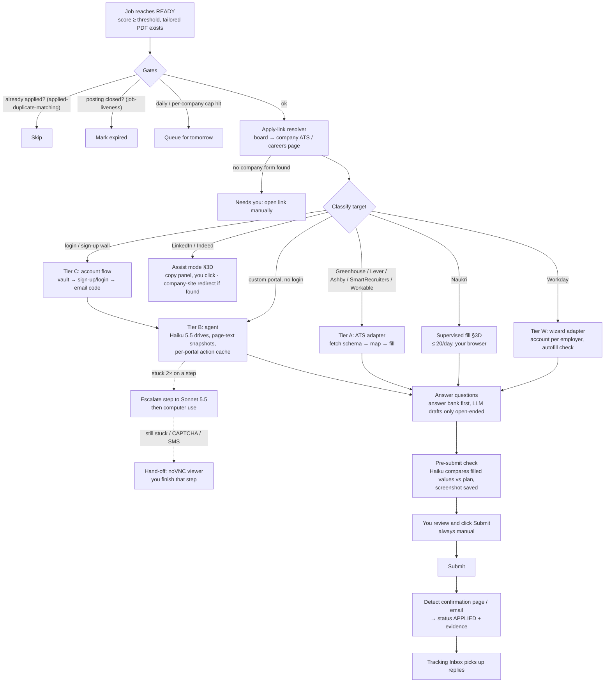
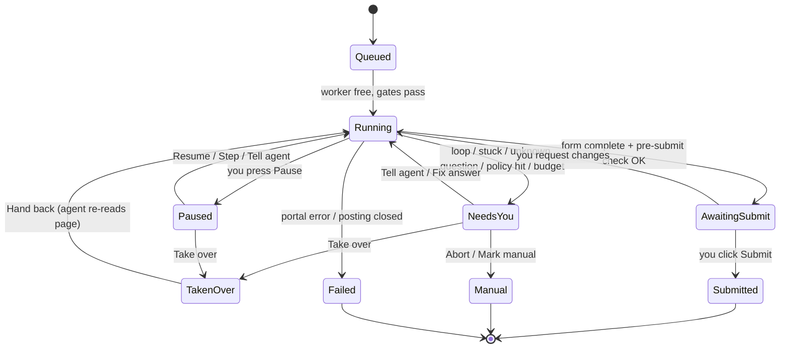
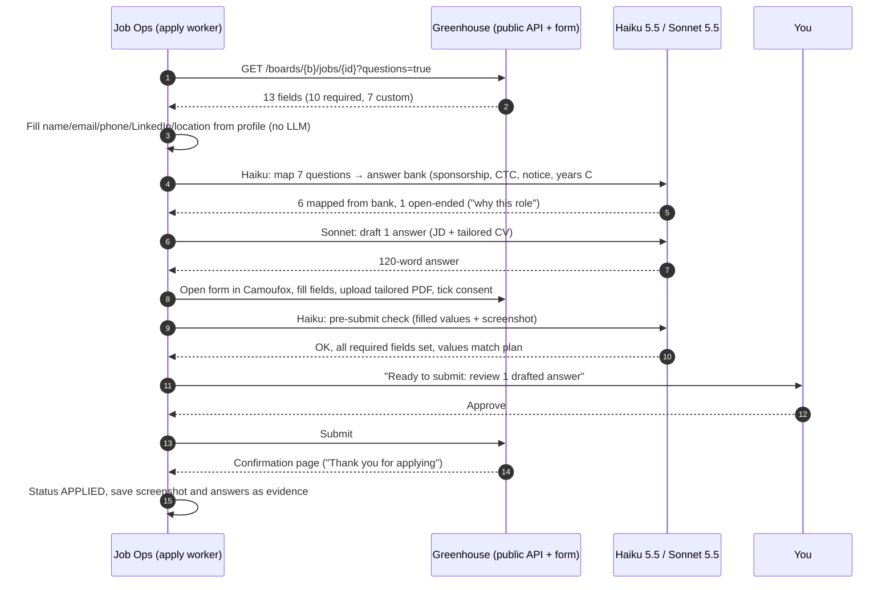
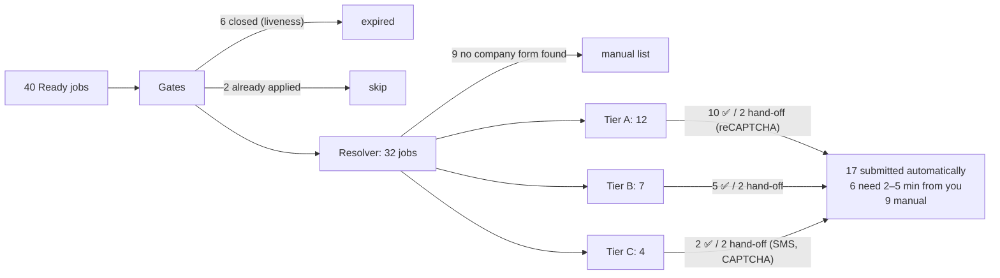
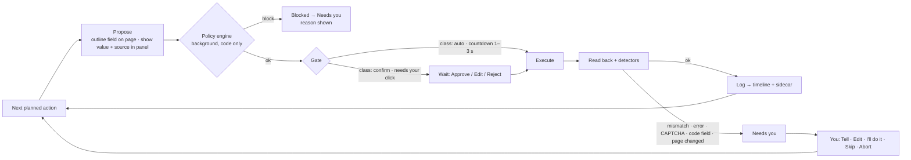

# Auto-Apply to Company Job Portals: Feasibility, Cost & Design

Research notes on adding an "apply for me" step to Job Ops: take a job that has
reached **Ready** (scored, tailored CV and PDF generated), open the company's own
careers portal, fill the application with the tailored resume, create an account
if the portal requires one, and submit.

Scope: **company job portals**, which means company-hosted career sites plus
the ATS forms companies link to:
- Greenhouse, Lever, Ashby, SmartRecruiters, Workable, Personio, Recruitee…
- **Workday**, brought into scope on the condition that live supervision works
  well (§3C)

**Job boards with "easy apply"** (LinkedIn Easy Apply, Indeed Apply, Naukri and
similar) are now included, **under each platform's own rules** (§3D). Where a
platform forbids automating its apply flow, Job Ops *assists* (answers ready to
paste, links, tracking) instead of clicking for you. Each posting is also
resolved to the company's own portal where possible (§2.1).

**Supervision model:** **every browser action is supervised** (§5A.0). You
supervise on and off, so the system behaves differently when you're present
and when you're away. You type mobile OTPs yourself in the supervision panel.

**Geography:**
- India-based roles and remote roles open to someone in India (§3A). Every one
  of the 1,225 jobs in the DB matches India or remote today.
- **Visa-sponsorship roles in Europe and Asia** (§3B): UK, Netherlands,
  Germany, Ireland and the Nordics in Europe; Singapore and Japan first in
  Asia. US and Canada are not targeted.

Date: 2026-10-19. Branch: `feature/credit-savings-remote-focus`.

---

## 1. TL;DR

- **It's feasible.** The best design is a **tiered hybrid**, not one general-purpose agent:
  - **Tier A, known ATS forms (Greenhouse, Lever, Ashby…):** fill the form deterministically from the form's own schema. The LLM only maps questions to your saved answers and drafts the occasional open-ended answer. About **$0.01 per attempt**.
  - **Tier B, custom company portals:** a cheap model (Claude Haiku 5.5) drives the browser using the page's text structure, not screenshots. It escalates to Sonnet 5.5 only when stuck, and remembers the steps for each portal so repeat visits are cheaper. About **$0.10–0.15 per attempt**.
  - **Tier C, portals that need an account:** Tier B plus account creation, a stored password per site, and reading the verification email through the Gmail connection you already have. About **$0.15–0.25 per attempt**.
  - **Fallback, a human:** the existing noVNC challenge viewer for CAPTCHAs, SMS codes and anything the agent can't confidently answer.
- **Blended cost ≈ $0.08 per attempt, ≈ $0.11 per successful application** (mix in §7). A screenshot-driven general agent (the OpenClaw/ZeroClaw style, or computer use everywhere) costs **$1–3 per application** for similar or worse accuracy.
- **OpenClaw is the wrong core.** It's a personal-assistant gateway (chat channels plus skills), not a pipeline component. Its browser tool is general-purpose and token-hungry, it has no per-portal memory, and in 2026 its skills marketplace had a serious malware problem (§4). ZeroClaw is a lighter Rust rewrite of the same idea and doesn't fix the core mismatch. Either could optionally serve as a phone approval channel ("Approve submit? ✅/❌"), but a plain Telegram bot does that more safely.
- **The biggest blocker isn't the agent, it's your data:**
  - **Only ~13% of your 1,225 jobs (≈155) link to a company portal or ATS.** 55% are LinkedIn and 18% Naukri. v1 needs an **apply-link resolver** that finds the same job on the company's own ATS (§2.1).
  - **Links go stale fast.** 13 of 25 Greenhouse links and 6 of 6 Lever links in your DB were already closed. Apply soon after scoring, and re-check liveness before every attempt.
  - **Invisible reCAPTCHA plus a datacenter IP** is the most-reported failure for auto-apply bots on Greenhouse (§9).
- **India changes the mix (§3A):**
  - **Two kinds of employer dominate your company-portal jobs.** Foreign startups hiring remote-from-India mostly use Greenhouse, Lever, Ashby, Workable or Rippling, which suits Tier A. Big companies' India centres in Bengaluru and Hyderabad mostly use enterprise ATSs (iCIMS, Oracle/Taleo, SuccessFactors, Phenom, Dayforce). Those need accounts and often show hCaptcha, so they're Tier C and the hardest.
  - **Indian forms ask for more personal data:** current/expected CTC, notice period and buyout, and on some portals 10th/12th/graduation marks, date of birth and gaps. The answer bank needs these fields.
  - **Mobile OTP is common** on Indian-built portals. The run pauses with an **OTP box in the supervision panel**, you type the code, and the agent continues.
  - **Freshteam is being shut down** (renewals stop in 2026), so don't build an adapter for it. The mass-hiring portals of TCS, Infosys and Wipro (Aadhaar-matched registration, assessments) are out of scope.
  - **India-adjusted cost: about $0.10 per attempt, about $0.15 per successful application**, with roughly 1 in 3 attempts needing a few minutes from you.
- **Visa-sponsorship roles in Europe and Asia (§3B) need a discovery fix first.**
  - **None of your current jobs is a strong sponsor match,** and only ~23 are abroad.
  - Searches need to target the UK, NL, Germany, Ireland, the Nordics, Singapore and Japan.
  - A free **visa-feasibility gate** sits in front of the apply queue:
    - **UK and NL:** official sponsor-register match.
    - **Everywhere:** salary vs that country's 2026 visa floor, plus a check for "no sponsorship" wording.
    - **Asia:** there are no public sponsor registers, so the gate looks for "visa support / relocation" wording instead.
  - Sponsorship answers are protected and always truthful.
- **LinkedIn, Indeed, Naukri and other easy-apply boards (§3D)** hold 73% of your jobs.
  - **LinkedIn**'s User Agreement bans bots and automating extensions. It's confirmed to scan browsers for **6,236 known extensions**, and restrictions escalate from a warning to a temporary restriction to a ban.
  - **Indeed**'s terms explicitly prohibit automating Indeed Apply outside Indeed's own tools.
  - **Naukri** caps applications at **50 a day** and forbids software that interferes with the site, but doesn't name bots.

  The plan is:
  - **Assist mode** on LinkedIn and Indeed: answers ready to copy, the tailored CV, one-click "mark applied". Nothing is clicked or typed on their pages, and Indeed's own *Apply For Me* is used where it's available.
  - **Supervised fill** on Naukri, at human pace and well below its cap.
  - **Never** headless or server-side runs on any of them.

  The behaviours that get accounts banned are listed in §3D.3, and the design avoids every one.
- **Workday is now in scope (§3C)**, because it carries many large European and Asian sponsors.
  - Every Workday site walks you through the same six steps, so a dedicated adapter can handle most of it.
  - The hard part is one **account per employer**. The credential vault and your supervision cover that.
- **Every action is supervised (§5A.0).**
  - **While you're watching:** each action is shown *before* it runs, with a short veto countdown (or a required click, if you prefer). You can intervene at any moment: pause, step, tell the agent, edit its next action, take over the browser, type an OTP, fix an answer, undo, or abort.
  - **When you step away:** the browser stops. Only background prep (finding the company link, reading the form, drafting answers and cover letters) continues, and runs wait in a queue until you're back.
  - **Nothing is ever submitted without your click.**
- **One picture of the whole pipeline** is in §5B, plus an interactive visualisation, **Apply Control Room**: https://claude.ai/artifact/X23jtCYrintVzx8MrV57cw (private to you until shared).
- **Phased by value ÷ effort (§10):**
  - **Phase 0** (small): a separate *apply-assistant* service with:
    - the queue of Ready jobs, with each job's **company apply link**, liveness and duplicate checks
    - the visa-feasibility gate
    - the answer bank and pre-drafted answers
    - EU/Asia search presets, which are configuration, not code
  - **Phase 1** (medium, the biggest win): an **Apply Copilot browser extension.**
    - The agent fills forms **in your own browser**, and you approve, edit or reject every action from a side panel.
    - Using your real browser and your home IP removes most CAPTCHA, IP, account and OTP problems, and it works on every portal, including Workday, from day one.
  - **Phase 2:** multi-page driving, Workday wizard and ATS adapters, portal recipes.
  - **Phase 3** (large): server-side supervised runs with the noVNC console, Away-mode prep, a credential vault and side-by-side runs.
  - **Phase 4:** more job sources, lighter supervision.
- **Fork-portable by design (§10A):**
  - Auto-apply is a **separate service with its own database** (not a workspace package and not a Job Ops schema change).
  - It talks to Job Ops **only through its existing HTTP API** and ships through a **compose override file**.
  - It adds **zero edits to upstream-owned files**, except an optional one-line nav link.
  - Contract tests run after every `git merge origin/main`, so an upstream API change is caught immediately.

---

## 2. What your data says

Read-only counts from the production DB (`/app/data/jobs.db`, 1,225 jobs), classified by apply-link host:

| Apply link host | Jobs | Share | In v1 scope? |
|---|---:|---:|---|
| LinkedIn | 679 | 55.4% | ❌ (resolver can find the company copy) |
| Naukri | 220 | 18.0% | ❌ (same) |
| Other: company career sites, Wellfound, Remotive, `grnh.se` short links… | 110 | 9.0% | ✅ mostly |
| startup.jobs / Arbeitnow / RemoteOK (boards) | 141 | 11.5% | ❌ (resolver) |
| Greenhouse | 22 | 1.8% | ✅ Tier A |
| Workday | 16 | 1.3% | ✅ Tier W, supervised (§3C) |
| Indeed | 14 | 1.1% | ❌ |
| Ashby / Lever / SmartRecruiters / Workable / Jobvite / iCIMS | 23 | 1.9% | ✅ Tier A (iCIMS → B) |

The "other" bucket includes real company portals (`careers.bp.com`, `jobs.apple.com`, `careers.netapp.com`, `pepsicojobs.com`), small ATSs (Freshteam, Zoho Recruit, Trakstar, PyjamaHR, Oorwin), and a few more boards (Wellfound, WhatJobs, Remotive).

**Takeaway:** without a resolver, v1 could only reach about 155 of 1,225 jobs.

### 2.1 Apply-link resolver (cheap, mostly no LLM)

For a LinkedIn, Naukri or board job, find the same posting on the company's own ATS:

1. Normalise the company name into likely board slugs (`"Zeta Global"` → `zetaglobal`, `zeta-global`, `zeta`).
2. Query the public, unauthenticated job-board endpoints:
   - `boards-api.greenhouse.io/v1/boards/<slug>/jobs`
   - `api.lever.co/v0/postings/<slug>?mode=json`
   - `api.ashbyhq.com/posting-api/job-board/<slug>`
3. Fuzzy-match on title and location. Haiku 5.5 settles ambiguous matches for about $0.0005.
4. If nothing matches, fall back to the company careers page found on its website. That page becomes a Tier B target.

Cost is near zero (HTTP plus the odd Haiku call). Caching slug → ATS per company makes later lookups free. This doesn't touch LinkedIn's apply flow at all. It only uses LinkedIn's data (title and company) to find the company's own form.

---

## 3. What real application forms look like

I pulled the **public form schemas** for every Greenhouse job in your DB (`GET boards-api.greenhouse.io/v1/boards/<board>/jobs/<id>?questions=true`, no auth needed) and the Lever apply pages:

| | Result |
|---|---|
| Greenhouse links checked | 25 (after resolving `grnh.se` short links) |
| Still live | **10** (13 closed, 2 couldn't be parsed or fetched) |
| Lever links checked | 6, **all closed** (404) |
| Avg fields per live form | **12.7** (10.2 required) |
| Avg custom questions | **7.0** (5.5 required); range 5–10, every form had some |
| Free-text custom questions | 4.6 per form |
| Dropdown or multi-select questions | 2.4 per form |
| File uploads | 1.7 per form (resume, optional cover letter) |
| Location question | 8 of 10 |
| Privacy/GDPR consent checkbox | **10 of 10** |
| Optional demographic/EEO section | 4 of 10 demographic, 3 of 10 compliance |

Sample of the actual custom questions:

- *Will you now or in the future require sponsorship for employment visa status?*
- *Are you legally authorized to work in India?*
- *Desired Salary* / *Add your current CTC* / *Expected CTC*
- *Notice Period (mention if you have buyout option or if it's negotiable)*
- *How many years of professional experience do you have with C# and .NET?*
- *Have you built production LLM applications using RAG, tool calling, and agentic frameworks…*
- *This role requires you to work from our office in Bangalore, 5 days…* (confirm)
- *Do you have any familial or close personal relationships with a current employee?*
- *How did you hear about this opportunity?* / *Preferred First Name* / *What pronouns do you use?*

**What this means for the design:**

1. **Most custom questions are factual and personal**, not creative: sponsorship, work authorisation, salary, notice period, years with X, relocation. An LLM must **never invent** these. They need a user-approved **answer bank** (§8.3), and the LLM's only job is to *map* a question to the right saved answer.
2. **Genuinely open-ended questions are rare.** Maybe 0–1 per form, like "why do you want to work here", and they are what LLM writing is good for.
3. **Consent checkboxes appear on every form.** Ticking a privacy consent is a legal act on your behalf, so the design needs your standing authorisation for it (§9).
4. **Liveness matters more than speed.** Half the stored links had already closed. Apply within a day or two of scoring, and always re-check liveness right before an attempt (the `job-liveness` service already exists).

---

## 3A. India and remote-from-India specifics

### 3A.1 What's behind your company-portal links

I probed every **open** (non-expired) company or non-board ATS link in the DB: 35 URLs, one plain HTTP GET each, no forms touched. I checked whether the posting was alive, which ATS ran it, and what CAPTCHA, login wall or Cloudflare protection showed up in the page HTML:

| Platform behind the link | Count | Who uses it | CAPTCHA / protection seen | Tier |
|---|---:|---|---|---|
| **iCIMS** (incl. embedded on company domains) | 5 | MNC India centres (e.g. Atlassian APAC, PepsiCo, Booking Holdings CoE) | **hCaptcha** (4 of 5) | C (account) |
| **Oracle HCM / Taleo** | 2 | MNCs (e.g. Uber) | — in HTML; account flow | C |
| **SAP SuccessFactors**, **Phenom**, **Dayforce** | 3 | MNCs (BASF, Danaher, Natus) | reCAPTCHA, Cloudflare | C |
| **SmartRecruiters** | 3 | MNCs hiring in India (e.g. ServiceNow, Eurofins) | Cloudflare | A |
| **Workable** | 2 | remote startups | reCAPTCHA + Cloudflare | A |
| **Rippling ATS** | 2 | remote US startups | **Cloudflare Turnstile** | A (needs a careful browser) |
| **Freshteam** | 2 | Indian startups (Haptik, Bito) | reCAPTCHA | ⚠️ product is being shut down |
| **Zoho Recruit**, **Breezy**, **Jobvite** | 3 | Indian SMEs / remote startups | — | A/B |
| Custom career sites | 13 | Capgemini, Applied Materials (**login + reCAPTCHA**), Amgen (reCAPTCHA), Chalhoub, R3, Bizzdesign… | mixed | B/C |
| **Dead links** (404 / "not found") | **8 of 35 (23%)** | | | — |

The CAPTCHA counts are a **lower bound**: many forms only load the widget on the apply step, which a plain GET doesn't reach.

**Of the 217 jobs that scored ≥ 60, only about 19 link straight to a company portal or ATS**: Greenhouse 3, Lever 2, SmartRecruiters 2, Workable 1, Rippling 1, Freshteam 1, Trakstar 1, and about 8 custom or enterprise portals. The other 198 point at LinkedIn (118), Naukri (37) or job boards. For India, the **apply-link resolver (§2.1) is mandatory**, not optional.

### 3A.2 Indian ATS landscape (portals you'll meet once the resolver runs)

| ATS | Typical users | Candidate flow | Plan |
|---|---|---|---|
| **Zoho Recruit** | Indian SMEs, staffing agencies (most commonly cited SME ATS) | Public apply form; optional candidate portal with **email-OTP** sign-up | Tier A adapter (phase 2) |
| **Keka Hire** | mid-size Indian companies (Keka HRMS customers) | Public careers page; admins configure fields (text, number, multiple choice), so expect custom questions | Tier A/B, verify on live postings |
| **Darwinbox** | large Indian enterprises | **Candidate login**: sign up, mandatory profile, verify contact details | Tier C |
| **Naukri RMS** | Indian enterprises tied to Naukri | Branded career site; may push candidates to a Naukri login | Treat as out of scope if it needs a Naukri login |
| **Freshteam** | Indian startups | Public form + reCAPTCHA | ❌ being shut down (renewals stop in 2026); don't build |
| **SuccessFactors / Oracle / iCIMS / Phenom / Workday** | MNC India centres (GCCs) | Account required; often hCaptcha/reCAPTCHA | Tier C (Workday → Tier W) |
| **TCS NextStep / Infosys / Wipro portals** | mass hiring | Email OTP + CAPTCHA + **Aadhaar-matched** identity + assessments | ❌ out of scope |

**Resolver additions for India:** besides Greenhouse, Lever and Ashby, try the predictable career-site subdomains Indian ATSs use. Typical patterns are `<company>.keka.com/careers`, `<company>.zohorecruit.in` / `.com`, and `<company>.darwinbox.in` candidate careers. Check these patterns against a handful of real companies before relying on them.

### 3A.3 Indian application questions → answer bank additions

Seen on the live Greenhouse forms of Indian and India-hiring employers in your DB (§3), plus what Indian ATSs commonly ask:

| Key | Notes |
|---|---|
| `ctc.current` (fixed + variable), `ctc.expected` | In INR lakhs per annum. Some forms want an annual number, some LPA. Store both forms |
| `notice_period`, `notice_buyout` | "30 days, buyout possible". Very common |
| `current_city`, `preferred_cities[]`, `willing_to_relocate` | Office-mandate questions ("5 days from the Bangalore office", confirm yes/no) |
| `work_auth.india = yes`, `sponsorship.india = no` | Asked even by India-based roles |
| `education.10th_pct`, `education.12th_pct`, `education.grad_cgpa`, `grad_year`, `gap_explanation` | Mostly IT-services and enterprise portals |
| `date_of_birth`, `gender` | Some Indian portals mark these required. Gender defaults to "prefer not to say" where allowed. **You decide** whether DOB may ever be auto-filled |
| `pan` / `aadhaar` | **Never auto-fill.** Hand off if required (mostly mass-hiring portals, which are out of scope anyway) |

### 3A.4 Remote-from-India specifics

- **Where these jobs are:** foreign startups on Greenhouse, Ashby, Lever, Workable, Rippling and Breezy, which suits Tier A. They're found through RemoteOK, Remotive, startup.jobs, Wellfound and LinkedIn, so the resolver maps them to the ATS.
- **Extra questions to bank:**
  - `work_auth.us/uk/eu = no`, with `sponsorship` per country
  - `timezone_overlap`, e.g. "can overlap 4 h with US Eastern"
  - `employment_type_ok`: contractor, employer-of-record (EOR) or full-time
  - `expected_comp_usd`, kept separate from the INR CTC
- **"Remote" often isn't remote for India.** Many US/EU "remote" roles quietly require local work authorisation. The pre-filter should drop jobs whose form asks for US/EU authorisation as a *required yes* before an application is spent on them. That check is free with Greenhouse's public schema.
- **Wellfound** applications happen inside Wellfound with an account. Treat it like LinkedIn: use the resolver to find the company's own ATS.

### 3A.5 India-specific risks

- **Mobile OTP** (Darwinbox, Naukri-linked portals, many custom Indian sites):
  - The run pauses in **Needs you → OTP** and the supervision panel shows an **OTP input box** with the portal name and the masked phone number the portal displayed.
  - You type the code and the agent enters it and continues.
  - Codes are never stored.
  - The same box handles email OTPs when the Gmail poller can't find the email.
- **DPDP Act 2023 (Rules notified 13 Nov 2025, phasing in over ~18 months):**
  - Employers are the data fiduciaries for application data. Employment-purpose processing doesn't always need consent, but they still owe notice, security and deletion duties.
  - Running Job Ops **for yourself** on your own data is personal use. That position should be confirmed if Job Ops is ever offered to other users, because an agent applying on someone else's behalf could fall into processor or consent-manager territory.
- **IP geography:** Indian portals see your profile location (India) and the browser's IP. Running the apply worker on your home connection gives a **residential Indian IP**, which is both less bot-like and geo-consistent. This strengthens the §11 recommendation.

### 3A.6 India-adjusted cost

Mix for company-reachable India/remote jobs after the resolver (estimate): Tier A 45%, Tier B 20%, Tier C 35% (more enterprise portals).

| | Share | Cost / attempt | Auto-success | Weighted cost |
|---|---:|---:|---:|---:|
| Tier A | 45% | $0.01 | 85% | $0.0045 |
| Tier B | 20% | $0.12 | 70% | $0.024 |
| Tier C | 35% | $0.20 | 45% (OTP, hCaptcha) | $0.070 |
| **Blended** | | **≈ $0.10 / attempt** | **≈ 68%** | **≈ $0.15 per auto-success** |

At 100 attempts a month that's **about $10 in model costs**, plus 2–5 minutes of your time for each of the roughly 32 attempts that need a hand-off.

---

## 3B. Visa-sponsorship roles in Europe and Asia

Scope addition: besides India and remote-from-India roles, include **roles in European and Asian countries whose employers can sponsor a work visa for someone moving from India**. US and Canada are not targeted.

### 3B.1 Where Job Ops stands today

- Job Ops already loads the **official sponsor registers** and matches employers against them (`visa-sponsor-providers/`), storing `sponsorMatchScore` and `sponsorMatchNames` on each job:
  - UK Home Office Register of Licensed Sponsors
  - Netherlands IND public register of recognised sponsors
  - US USCIS H-1B employer data
  - Canada open-data LMIA list
- **Your current jobs barely use it:**
  - 824 jobs have a sponsor score, but **none scores ≥ 70**. They're almost all India-based, where it doesn't apply.
  - Only about 23 jobs are outside India and not remote, mostly German cities via Arbeitnow.
- **So the first blocker is discovery, not applying.** Searches need to target the sponsorship countries (UK, Netherlands, Germany, Ireland, Sweden, Denmark, Singapore, Japan), and sponsor-matched jobs need to rank higher. Possible additional sources for Asia: Japan-dev's "visa sponsorship" listings, and Singapore's MyCareersFuture government job bank (employers must advertise there under the Fair Consideration Framework). That's a pipeline/search-settings change, separate from the apply engine. The engine below works unchanged on those jobs.

### 3B.2 Country rules that decide whether a role is worth applying to (2026)

| Country | Route | Employer must be… | Salary floor (2026) | Data already in Job Ops | Priority |
|---|---|---|---|---|---|
| **UK** | Skilled Worker | a **licensed sponsor** (Home Office register) | general threshold **£41,700/yr** or the occupation going rate, whichever is higher (most sources; verify on gov.uk) | ✅ UK register | High |
| **Netherlands** | Highly Skilled Migrant | an **IND recognised sponsor** | **€5,942/month** (30+) · **€4,357** (<30) · €3,122 recent grads, excl. holiday pay | ✅ NL register | High |
| **Germany** | EU Blue Card | any employer, **no sponsor licence** | **€50,700/yr**; **€45,934.20** for shortage occupations, incl. qualifying IT specialists | ❌ no register needed; filter on salary + role | High (most accessible) |
| **Ireland** | Critical Skills Employment Permit | any employer (permit is per job) | **€40,904/yr** with a relevant degree (from 1 Mar 2026); €68,911 without a degree | ❌ no register | High (English-speaking, tech hub) |
| **Sweden** | Work permit | any employer | **90% of the median salary** from 1 Jun 2026 (≈ SEK 33,400–34,500/month; sources differ, check Migrationsverket) | ❌ | Medium |
| **Denmark** | Pay Limit Scheme | any employer | **DKK 552,000/yr** (ordinary scheme, 2026) | ❌ | Medium |
| **Singapore** | Employment Pass | any employer; **COMPASS** points + Fair Consideration Framework (local-first advertising) | **S$5,600/month** minimum, rising with age (S$6,200 in financial services); **S$6,000 from Jan 2027** | ❌ no register | High (English, big tech hub) |
| **Japan** | Engineer/Specialist visa (or Highly Skilled Professional by points) | any Japanese-registered employer | no fixed floor for Engineer; HSP needs ≥ 70 points | ❌ | Medium. **Language**: many forms and roles need Japanese; filter to English-speaking roles |
| Other Asia (UAE, Hong Kong, Malaysia…) | various | various | not researched yet | ❌ | Add once the above work |
| ~~US / Canada~~ | — | — | — | ✅ data exists | **Not targeted** (your choice) |

### 3B.3 Visa-feasibility gate (free, before any apply cost)

Sponsorship applications are only worth sending if the employer *can* sponsor and the role clears the visa's salary floor. Add a gate in front of the apply queue:

1. **Sponsor register match:** UK and NL require `sponsorMatchScore` ≥ 85 (tune it). Countries without a public register (Germany, Ireland, Nordics, Singapore, Japan) skip this check. They use an LLM-free phrase check for **visa support / relocation** wording in the posting ("visa sponsorship available", "relocation package", "we support Blue Card / Employment Pass applications"), plus the employer's past sponsorship history from your own applications.
2. **Salary vs the country floor,** when the posting states a salary: drop clear misses and flag unknowns.
3. **"No sponsorship" phrase pre-reject:** for example *"must have the right to work in the UK"*, *"we are unable to sponsor"*, *"no visa sponsorship"*. This is free and already on the cost-saving roadmap.
4. **Form-level knockout check (Tier A only):**
   - Greenhouse's public schema shows whether the form asks *"Will you require sponsorship?"* or *"Do you have the right to work in X?"* as **required**.
   - The answer will truthfully be **yes**, sponsorship needed. Many employers auto-reject on that, so those jobs score lower. They aren't skipped automatically unless you choose that.
5. **Never misstate visa status.** `sponsorship.<country> = yes` and `right_to_work.<country> = no` are protected answer-bank keys (§5A.4). The agent cannot change them, and saying otherwise would void any offer anyway.

Result: a **visa-feasibility score** next to suitability, so the apply queue for abroad roles holds only jobs where sponsorship is realistic.

### 3B.4 Portals sponsor employers use

| Portal | Typical employers | Plan |
|---|---|---|
| **Workday** | large European and Asian sponsors (banks, consultancies, big tech, Singapore regional HQs) | ✅ **now in scope via the Workday adapter (§3C)**, under full supervision |
| **SAP SuccessFactors, Oracle, iCIMS** | large enterprises | Tier C |
| **Greenhouse, Lever, Ashby** | London, Amsterdam and Berlin tech scale-ups (frequent sponsors) | Tier A ✅ |
| **SmartRecruiters, Workable** | mid-size EU/UK companies | Tier A |
| **Personio** | German SMEs and scale-ups (Blue Card track) | Tier A/B adapter candidate. Verify whether a public job feed exists for the resolver |
| **Teamtailor** | Nordics / UK / NL | Tier B |
| **Recruitee** | NL / EU | Tier A/B candidate |
| **NHS Jobs / Trac, Civil Service Jobs** | UK public sector (many sponsor) | ❌ account-heavy national portals; later phase at best |

### 3B.5 Answer-bank additions for sponsorship roles

| Key | Example |
|---|---|
| `sponsorship.uk/nl/de/ie/se/dk/sg/jp` | yes (protected) |
| `right_to_work.<country>` | no (protected) |
| `visa_route.<country>` | "Skilled Worker" / "Highly Skilled Migrant" / "EU Blue Card" / "Critical Skills Employment Permit" / "Employment Pass" / "Engineer visa" |
| `earliest_start_abroad` | notice period + typical visa lead time, e.g. "~3 months from offer" |
| `relocation_abroad` | yes; relocation support welcome / required |
| `salary_expectation.<currency>` | per country, **at or above that country's visa floor** |
| `languages` | e.g. German A2, Japanese N4: asked on many German and Japanese forms |
| `current_location` | "Bengaluru, India" (honest; drives expectations) |

EU forms more often require a **cover letter** (Germany especially). Job Ops already tailors the CV, so drafting a short, role-specific cover letter for these jobs is the one place where spending Sonnet tokens clearly pays off.

### 3B.6 Cost and volume

- Per-attempt cost follows the same tiers as before (§7). Scale-up roles on Greenhouse, Lever or Ashby are cheap, while enterprise portals are Tier C.
- Response rates for sponsorship applications from abroad are lower. The gate (§3B.3) does more for results than raw volume, so **favour fewer, well-targeted applications** with a cover letter over bulk submission.

---

## 3C. Workday (now in scope, supervised)

Why include it: many large European and Asian sponsors (banks, consultancies, big tech, regional HQs in Singapore) recruit through Workday. Excluding it would cut off a large share of the sponsorship track.

**What makes Workday automatable:**
- **The same wizard on every employer's site:** *My Information → My Experience → Application Questions → Voluntary Disclosures → Self Identify → Review*. A dedicated adapter can drive these steps.
- **Elements carry `data-automation-id` attributes,** which open-source auto-apply projects use as selectors. Their stability across employers is a project claim, not a Workday guarantee, so the adapter falls back to the agent when a selector misses.

**What makes it hard:**
- **One candidate account per employer.** An account at one company's Workday site is useless at another, so every new employer means sign-up and email verification. The credential vault (§8.1) handles this, and you see every account-creation step.
- **Resume autofill rewrites your data.** *My Experience* parses the uploaded CV and often mangles dates, titles or employers. The adapter compares every autofilled field with your profile and fixes or flags differences. This is the most important check on Workday.
- **Long forms, plus required yes/no and dropdown questions,** which come from the answer bank.
- **Voluntary Disclosures / Self Identify** get your chosen defaults ("prefer not to say" where allowed).
- **Possible simplification:** Workday has reportedly announced a reusable **Candidate Profile** (email + one-time code, pre-filling most standard fields, no per-employer password). This isn't verified. If it ships, the account burden mostly disappears and the code arrives through the OTP flow.

| | Estimate |
|---|---|
| Steps per first application (incl. sign-up) | 40–70 |
| Model cost per attempt (adapter + Haiku fallback + checks) | **$0.05–0.12** |
| Your time while supervising | 6–12 minutes for a first visit to that employer, 3–5 for repeats (account exists) |
| Tier | **W**: deterministic wizard adapter + agent fallback + account vault |

Rollout: Workday comes **after** the supervision console has proven itself on Tier A and B portals, as you specified.

---

## 3D. Job boards with "easy apply": LinkedIn, Indeed, Naukri and others

These boards hold **~73% of your jobs** (LinkedIn 679, Naukri 220, Indeed 14 of 1,225). Applying there is quick, which is exactly why the platforms police automation hard. **Your own account is what gets restricted**, so the platform's rules decide how far Job Ops goes.

### 3D.1 What each platform's rules say

| Platform | Rule on automation | Enforcement seen | Notes |
|---|---|---|---|
| **LinkedIn** (Easy Apply) | User Agreement §8.2 (as quoted by several sources) bars bots and unauthorised automated methods. LinkedIn's help pages extend that to **third-party extensions that automate activity** | **Confirmed:** LinkedIn's site runs a script probing for **6,236 browser extensions** by ID and collects device details (CPU cores, memory, screen, timezone…). LinkedIn says it uses this "to determine which extensions violate our terms." Vendor reports describe escalation from warning to temporary restriction to permanent ban, sometimes straight to suspension for non-human sessions | Some reports say a popular auto-apply extension is on a public "risky plugins" list. No LinkedIn statement ties one extension ID directly to a restriction |
| **Indeed** (Indeed Apply) | Terms (per a ToS tracker, July 2026): *"use of any automation, scripting, or bots to automate the Indeed Apply process outside of Indeed's official vendors and tooling is prohibited."* Indeed may suspend accounts at any time | Detection criteria not public | Indeed has its own **"Apply For Me"** tool, now mentioned in its terms. Availability in India is **not verified** |
| **Naukri** | Terms forbid software that interferes with the site or places an unreasonable load. **Bots aren't named** | **Hard cap: 50 applications per day** (Naukri FAQ); "apply quota exhausted" errors reported | Native bulk apply lets you tick up to 5 postings and apply in one go. Recruiter screening questions ("chatbot") are common |
| **Wellfound, Instahyre, Cutshort, foundit, Hirist, Glassdoor** | **Not yet reviewed** | — | Default to assist mode until each site's terms are checked. Glassdoor applications generally run through Indeed Apply |

### 3D.2 What Job Ops does on each

| Platform | Mode | What happens |
|---|---|---|
| **LinkedIn** | **Assist** (default) | The Copilot side panel shows the job's answers (bank + drafted), the tailored CV to attach, and "copy" buttons. **You** click Easy Apply and paste. The extension **does not read or change linkedin.com pages**: its host permissions exclude LinkedIn. After you submit, "Mark applied" updates Job Ops through its API. It also offers **"apply on company site instead"** when the resolver found the employer's own posting, which avoids LinkedIn's rules entirely |
| **Indeed** | **Assist**, plus Indeed's own *Apply For Me* where available | Same as LinkedIn. Indeed's official tool is the only sanctioned automation |
| **Naukri** | **Supervised fill** (opt-in per account) | The Copilot fills Naukri's apply form and screening questions in your own logged-in browser, **one proposed action at a time with your approval**. The daily cap is set to **≤ 20** (well under the 50 hard cap). No bulk loops, no background runs |
| **Other boards** | Assist until reviewed | Upgrade a board to supervised fill only after reading its terms |
| **Any board** | ❌ never | Headless or server-side runs, scraping while logged in, parallel sessions, or anything run from the VPS on your account |

Job Ops already collects LinkedIn jobs without logging in (via jobspy, upstream behaviour). Keep that **completely separate from your account**: the logged-in browser is never used for discovery, and the discovery scraper never uses your login.

### 3D.3 Behaviours that get accounts restricted, and how the design avoids them

| Ban trigger (reported) | Why it flags | Design |
|---|---|---|
| **Cloud or datacenter IPs** for a logged-in account | Your account suddenly acting from a server | Board applications only from **your own browser at home**. Phase 3 server-side runs are **company portals only** |
| **High volume / bursts** (dozens per hour, hitting caps) | Inhuman throughput | Per-board daily caps (LinkedIn ≤ 15, Naukri ≤ 20, Indeed ≤ 15), a per-hour ceiling, no back-to-back submits |
| **Uniform timing** (every action N ms apart) | Machine rhythm | In assist mode you act yourself. In Naukri supervised fill each action waits for your approval, so pacing is naturally human |
| **Known automation extensions installed** | LinkedIn scans for 6,236 extension IDs | The Copilot does nothing on LinkedIn or Indeed pages. If you'd rather not have it detectable there at all, use a **separate browser profile** for LinkedIn/Indeed without the extension |
| **Browser injection / session hijacking signals** | Scripts driving the page | No injection on LinkedIn or Indeed. On Naukri, only supervised form fills |
| **Low-activity account suddenly applying at scale** | Out-of-character usage | Modest caps; keep using the account normally |
| **Generic, identical answers and templates** | Spam pattern; also hurts your chances | Answers are per job: bank facts plus job-specific drafts, never one copied template |
| **Logged-in scraping** (bulk profile or job-page views) | Classic bot pattern | Never. Discovery stays logged-out and separate |

**Out of scope on purpose:** hiding the extension from LinkedIn's scanner, spoofing fingerprints, rotating IPs or accounts, or otherwise disguising automation. Those are detection-evasion techniques: they break the platforms' terms and put your account at much higher risk. The approach here instead keeps Job Ops off the pages where automation isn't allowed.

### 3D.4 Effort and value

- **Assist mode costs almost nothing extra:** it's the Phase 1 Copilot side panel with "copy" buttons and "Mark applied", enabled on these domains *without* page access. It covers 73% of your jobs on day one.
- **Naukri supervised fill** reuses the Copilot fill loop with a Naukri-specific question mapper. Phase 2.
- **Company-site redirect** ("this LinkedIn job is also on the company's Greenhouse") is the highest-value step on these boards. It moves applications to channels where the full Copilot is allowed.

---

## 4. Options compared

| Option | What it is | Fit for this job | Est. cost / application | Accuracy on forms | Notes |
|---|---|---|---|---|---|
| **OpenClaw** | Self-hosted personal AI agent: chat gateway, skills, Chromium browser tool. MIT licence; you bring the model | ⚠️ Poor as the core | **$1–3+** (one source puts a single "check this webpage" at 15–50k tokens) | Medium; general-purpose, re-reasons every page from scratch | Node runtime around 1.5 GB RAM. 2026 security issues: hundreds of malicious ClawHub skills, CVE-2026-25253 (remote code execution through a crafted link), 40k+ exposed instances. Running an agent that holds your accounts and CV is risky |
| **ZeroClaw** | Rust rewrite of the OpenClaw idea; single binary of a few MB | ⚠️ Same paradigm, lighter | Similar per-token cost (the model is the cost, not the runtime) | Same as OpenClaw | Much smaller footprint and can import OpenClaw configs. Sources disagree on how complete its browser tooling is. Rust doesn't protect against prompt injection |
| **browser-use** | Python library, an LLM-driven browser agent (DOM and vision) | ✅ Good for Tier B | ~$0.02–0.11 per task reported | High on benchmarks (self-reported) | Python sidecar next to a TypeScript app. Chromium/CDP |
| **Stagehand** | TypeScript library on top of a real browser: `act()` / `extract()` / `observe()` plus agent mode | ✅ **Best fit for Tier B/C** | ~$0.01–0.06 per task, falling once cached | High; self-healing actions | **Action caching** (v3 local `cacheDir`) suits repeat visits to the same portal. Same language as Job Ops. v3 is built around the Chrome DevTools Protocol, so check whether it can drive Camoufox (Firefox) |
| **Skyvern** | Vision-first web agent; cloud or self-host | ⚠️ Viable but pricier | ~$0.50 per 10-step task (cloud) | High on hard visual sites | **AGPL-3.0**, which is awkward next to Job Ops' Commons Clause licence. Screenshot-heavy |
| **Claude computer use** (`computer_toolset_20260801`) | The model sees screenshots and drives mouse and keyboard | ✅ As an **escalation** only | $0.50–2+ if used for whole runs | High on odd widgets | Use it for the one step a text-based agent can't handle, not for the whole run |
| **Deterministic ATS adapters** (own code) | Read the form schema, fill known fields by selector | ✅✅ **Best for Tier A** | **≈$0.01** (LLM only for question mapping and the rare open answer) | Highest, because it's predictable and testable | Greenhouse exposes the schema publicly. Needs one adapter per ATS, and ATS markup changes |
| **Official "apply" APIs** (Greenhouse POST, Lever POST) | Server-to-server submission | ❌ Not usable | n/a | n/a | Both need the **employer's** API key ("To use the POST API, you need an API key"; Greenhouse uses HTTP Basic Auth). Candidates can't use them |

**Verdict:**
- Build **deterministic adapters for Tier A** yourself.
- For **Tier B/C**, spike **Stagehand** against a **thin agent loop of your own** (Playwright + page text structure + Claude tool use) on 20 real portals, then pick one. The own-loop option keeps Camoufox and has no extra dependency. Stagehand gives caching and self-healing for free.
- Keep **Claude computer use** as a narrow escalation.
- **Don't** put OpenClaw/ZeroClaw in the apply path.

---

## 5. Recommended architecture (hybrid)



### Where it plugs into Job Ops

| Piece | Reuse | New |
|---|---|---|
| Browser | `extractors/browser-utils` (Camoufox launch, cookie jar, challenge detection) | an apply worker process |
| Human hand-off | `services/challenge-viewer.ts` (noVNC session), already used for Cloudflare | a "resume after hand-off" signal |
| Liveness | `services/job-liveness/*` (built on this branch) | call it just before each attempt |
| Duplicates | `services/applied-duplicate-matching.ts` | — |
| Resume | `pdfPath` + `services/pdf-storage.ts` (the tailored PDF) | — |
| Email codes | Gmail OAuth from Tracking Inbox (scope `gmail.readonly` is enough to *read* codes and links) | verification-email poller |
| LLM | `services/llm` (provider-agnostic) | an apply-specific model policy (Haiku + Sonnet) |
| Status | `applicationTracking.ts` | `apply_attempts` table: tier, steps, tokens, cost, screenshots, outcome |

**Avoiding upstream merge conflicts:** auto-apply does **not** live inside `orchestrator/`. It runs as a separate **sidecar service** with its own database. It talks to Job Ops only through Job Ops' existing HTTP API, and reuses `browser-utils` read-only. See §10A for the full portability design. The "Reuse" column above means *calling these over the API or importing read-only*, not editing them.

---

## 5A. Live supervision: watch, step in, correct

Requirement: a person watching a run can see what the agent is doing, notice when it loops, is stuck or is doing the wrong thing, and then **tell it what to do**, **do the step themselves**, or **stop it**. This is designed in from day one, not bolted on.

The supervision loop below is the same in every phase. What changes is **where the browser lives** (§10):
- **Phase 1–2:** the agent works **in your own browser tab**, with the controls in an extension side panel. You see the real page, and "take over" simply means doing the step yourself.
- **Phase 3:** the agent works in a **server-side browser** that you watch through the noVNC Live Applications page.

### 5A.0 Every action is supervised: how that works when you're on and off

**While you're present** (the Live Applications page is open and active, detected by a heartbeat), every browser action goes through this cycle:

1. **Propose.** The agent shows the next action in the panel: *"Type `26 LPA` into *Expected CTC* (from bank key `ctc.expected`)"*. The target element is outlined in the live browser view.
2. **Policy check.** Code, not the LLM, validates the action: domain, protected keys, upload file, and no submit.
3. **Veto window.** The action runs after a countdown unless you press **Pause / Edit / Reject**. Pick the window per portal: **0 s** (you must click **Approve** for every action), **3 s** (default for new portals), or **1 s** (graduated portals). Even at 1 s you see and can stop every action.
4. **Execute and verify.** The result is read back and shown in the timeline with a screenshot.

**When you step away** (page closed, no heartbeat for 60 s, or you click **Away**):
- **No browser actions run.** In-flight runs stop at the next safe point (after the current field), and the browser session is kept.
- **Background prep keeps going:**
  - liveness checks
  - finding the company link
  - fetching form schemas
  - mapping questions to the answer bank
  - drafting open answers and cover letters
  - detecting sign-up walls
- When you return, the queue shows **"N applications ready to drive, ~M minutes of supervision"**, already sorted with the least-work runs first.
- An optional phone notification fires only when something actually needs you.

**Submit always needs your explicit click,** in every mode.

**Throughput while supervising:** Tier A ≈ 1–2 min, Tier B ≈ 3–6 min, Workday ≈ 6–12 min (first visit to an employer). An hour of supervision covers roughly **8–15 applications**. With two runs side by side (one driving, one waiting on an email or OTP), it's at the top of that range.

### 5A.1 What you see: a "Live Applications" page in Job Ops

```
┌─ Live Applications ──────────────────────────────────────────────────────────────┐
│ ● Running 2   ⏸ Needs you 1   ✓ Submitted today 7   Budget today $0.61 / $3.00  │
├──────────────────────────────────────────────┬───────────────────────────────────┤
│  LIVE BROWSER (noVNC, click to take over)    │  STEP TIMELINE                    │
│ ┌──────────────────────────────────────────┐ │ 12 ✓ fill "Notice period" ← bank  │
│ │  careers.example.com / Apply (page 3/5)  │ │ 13 ✓ select "Bengaluru"           │
│ │  [Current CTC: 18 LPA      ]             │ │ 14 ✓ upload tailored_cv.pdf        │
│ │  [Expected CTC: ______     ] ◄─ agent    │ │ 15 ⚠ click "Next" → no change     │
│ │  ( Next )                    highlight   │ │ 16 ⚠ click "Next" → no change     │
│ └──────────────────────────────────────────┘ │ 17 ⏸ PAUSED: loop detected        │
│ Agent's plan: "Click Next to reach page 4"   │    (same action, page unchanged)  │
│ Why stuck: required field "Expected CTC"     │                                   │
│ is empty and Next is disabled                │ Model: Haiku 5.5 · $0.041 so far  │
├──────────────────────────────────────────────┴───────────────────────────────────┤
│ [▶ Resume] [⏭ Step once] [🖐 Take over] [💬 Tell agent…] [✎ Fix answer] [⏹ Abort] │
│ 💬 "Expected CTC is 26 LPA. Use the bank key ctc.expected. Then press Next."      │
└──────────────────────────────────────────────────────────────────────────────────┘
```

- **Live browser view:** the browser runs headed inside a virtual display, streamed through the **existing noVNC challenge viewer** (`services/challenge-viewer.ts`), so it works the same on the VPS or your PC. The element the agent is about to act on is outlined, so you see the *next* move before it happens. If the worker runs on your home PC, you can simply watch the real browser window. The Job Ops panel then only adds the timeline and controls.
- **Step timeline,** streamed over SSE (the same mechanism as the existing pipeline progress stream). Each step shows:
  - the agent's intent in plain words
  - the target element
  - the value it typed (passwords and OTPs masked)
  - where the value came from (`bank` / `profile` / `LLM draft`)
  - the result (`page changed` / `no change` / `validation error`)
  - model and running cost
- **"Why stuck" explanation:** when a run pauses, the agent writes one sentence on what it thinks is blocking it. That's often enough for you to answer in a word.

### 5A.2 How you step in

| Control | What happens | Typical use |
|---|---|---|
| **⏸ Pause / ▶ Resume** | Run halts before its next action; the browser stays open | "Wait, that looks wrong" |
| **✅ Approve / ✏️ Edit next action / ✖ Reject** | Approve the proposed action, change it (target, value, choice) before it runs, or reject it so the agent proposes something else | Wrong dropdown option about to be picked |
| **🔢 Enter OTP** | OTP box shown when the portal asks for an SMS or email code; your code is typed in and never stored | Mobile OTP on Indian portals, Workday sign-up |
| **⏭ Step once** | Agent proposes one action and waits for your OK | Watching a new portal closely |
| **💬 Tell agent** | Your text goes into the agent's context as an operator instruction, outranking anything on the page, and it re-plans | "The location field is a typeahead: type 'Beng' and pick the first option" |
| **🖐 Take over** | Agent stops; you drive the browser in the noVNC view; **Hand back** makes the agent re-read the page and continue from where you left it | OTP, CAPTCHA, a weird date picker |
| **✎ Fix answer** | Edit a filled value or answer-bank entry; the agent re-fills | Wrong CTC unit, wrong city |
| **↩ Undo step** | Browser back / restore the previous field value | Agent selected the wrong dropdown option |
| **⏹ Abort / 📋 Mark manual** | Ends the run; the job goes to your manual list with the URL and what was already filled | Portal not worth it |

**Veto window (per portal, switchable mid-run):**
- **0 s:** approve every action by click. Use it for brand-new portals or when something went wrong.
- **3 s:** the default for portals the agent has seen fewer than 2 times.
- **1 s:** graduated portals, with 2 clean runs and no corrections.

In every mode you see each action before it runs, and **submit always needs your click**.

### 5A.3 When the agent stops itself and asks you

The run pauses and notifies you (browser notification, plus phone through Telegram or push if enabled) when any of these fire:

| Detector | Rule (starting values) |
|---|---|
| **Loop** | Same action on the same page fingerprint (URL + form-state hash) 2×, or an A→B→A→B cycle |
| **No progress** | 3 actions in a row with no page or field change |
| **Repeated validation error** | Same field error after 2 fix attempts |
| **Unknown question** | A question with no answer-bank match that isn't clearly open-ended |
| **Protected action** | Submit, "withdraw", "delete account", any payment, consent to new terms, leaving the portal domain |
| **Budgets** | > 40 steps, > $0.50 model spend, or > 12 minutes for one application |
| **Low confidence** | The model marks its own next step `confidence: low` (part of the action schema) |
| **Page change it can't classify** | A CAPTCHA, an OTP prompt, an error page or a login loop |

### 5A.4 Catching *incorrect* actions, not just stuck ones

- **Pre-action policy check (code, not the LLM),** run before every action:
  - The domain must stay inside the portal allowlist.
  - Protected answer-bank keys (CTC, work authorisation, DOB, attestations) can only be typed with the bank's value.
  - The submit button is unreachable without approval.
  - File uploads can only be the tailored PDF or cover letter for *this* job.

  A violation pauses the run and shows you what was attempted.
- **Post-step check:** after typing, read the field back. If the portal rewrote the value (autocomplete, unit change), flag it.
- **Pre-submit review screen:** every field and value, its source, and screenshots of each page. Mismatches are highlighted.
- **Recording:** a Playwright trace (screenshot + DOM snapshot per step) is saved for every run, so a run you didn't watch can be replayed afterwards.

### 5A.5 Your interventions teach the system

Every intervention is saved against the portal or the ATS:

- **Tell-agent hints** become part of that portal's notes, injected next time.
- **Take-over actions** are recorded as a **portal recipe**, a replayable sequence like Stagehand's action cache. The same widget is then handled automatically next time.
- **Answer fixes** update the answer bank.

The goal is that each portal needs you at most once or twice.

### 5A.6 Run states



### 5A.7 What this means for the engine choice

Supervision needs an agent loop that **stops between every action**, accepts **operator messages mid-run**, and can **re-observe** after a human changed the page.

- **Own loop (Playwright + page-text snapshot + Claude tool use):** full control over all of this. It's also simple to put the policy check and detectors around every call.
- **Stagehand:** good if driven step by step (`observe()` → policy check → `act()`), since every step passes through your code. Its fully autonomous agent mode is harder to interrupt cleanly.
- **OpenClaw / ZeroClaw:** you can chat to them mid-task, which is a plus. But there's no structured step timeline, policy hook or form-aware pause logic, so you'd be building the supervision layer around a black box.

**This tips the recommendation further toward the own loop**, with Stagehand's `act/observe` used inside it if the spike shows it handles widgets better.

**Practical limit:** keep concurrency at **1–2 live runs** while you're watching. Run larger unattended batches only for Tier A portals that have graduated.

---

## 5B. The whole pipeline in one picture

```mermaid
flowchart LR
    subgraph D["① Discover (existing, schedule)"]
        D1[Search runs<br/>India · remote · EU · Asia] --> D2[Dedupe + import]
    end
    subgraph S["② Score & prepare (existing + new gates)"]
        S1[AI suitability score] --> S2{Visa feasibility gate<br/>register · salary floor · phrases}
        S2 -->|pass / India-remote| S3[Tailor CV + PDF<br/>cover letter for EU/Asia]
        S2 -->|fail| SX[Skip + reason]
    end
    subgraph P["③ Background prep (runs without you)"]
        P1[Liveness + duplicate check] --> P2[Resolve company portal]
        P2 --> P3[Classify: A · B · C · W · Board]
        P3 --> P4[Fetch form schema<br/>map answers · draft open answers]
        P4 --> P5[(Supervision queue<br/>sorted by effort)]
    end
    subgraph L["④ Live supervised run (only while you're present)"]
        L1[Agent proposes action] --> L2[Policy check]
        L2 --> L3{Veto window<br/>0 s / 3 s / 1 s}
        L3 -->|approve / timeout| L4[Execute + read back]
        L3 -->|edit / reject| L1
        L4 --> L5{Detectors<br/>loop · stall · unknown Q · OTP · CAPTCHA}
        L5 -->|ok| L1
        L5 -->|needs you| L6[You: tell · edit · OTP · take over · fix · abort]
        L6 --> L1
        L4 -->|form complete| L7[Pre-submit review]
    end
    subgraph F["⑤ Submit & track"]
        F1[You click Submit] --> F2[Confirmation captured<br/>status APPLIED]
        F2 --> F3[Tracking Inbox<br/>replies · interviews]
        F2 --> F4[Portal recipe + answer bank<br/>updated from your interventions]
    end
    D2 --> S1
    S3 --> P1
    P5 --> L1
    L7 --> F1
    F4 -. next run is faster .-> L1
```



---

## 6. Simulated run

> **This is a simulation, not a live submission.** Form shapes come from the real Greenhouse schemas above. Token counts and success rates are estimates (§7). Nothing was submitted anywhere.

### 6.1 One Tier A application, step by step (a 7-custom-question Greenhouse form)



| Step | Model | Input tok | Output tok | Cost |
|---|---|---:|---:|---:|
| Fetch schema, liveness, duplicate check | none | — | — | $0 |
| Map 7 questions → answer bank | Haiku 5.5 | 6,000 | 600 | $0.0009 |
| Draft 1 open-ended answer | Sonnet 5.5 | 8,000 | 400 | $0.0200 |
| Fill and upload in browser (~60 s) | none | — | — | ~$0 (existing VPS) |
| Pre-submit check (2 screenshots + values) | Haiku 5.5 | 7,000 | 300 | $0.0009 |
| **Total** | | | | **≈ $0.022** |

If the form has no open-ended question, the total is **≈ $0.002**. The expected value per Tier A attempt is about **$0.01**.

### 6.2 One Tier C application (custom portal with sign-up)

```mermaid
sequenceDiagram
    autonumber
    participant W as Apply worker (Camoufox)
    participant P as careers.example.com
    participant A as Agent (Haiku 5.5 → Sonnet 5.5 on stuck steps)
    participant V as Credential vault
    participant M as Gmail (readonly)
    participant You
    W->>P: Open apply URL
    P-->>W: "Sign in or create an account"
    W->>V: Account for example.com?
    V-->>W: none → generate strong password, email you+example@gmail.com
    loop ~10 steps
        A->>W: next action from page-text snapshot (fill, click, select)
    end
    P-->>M: Verification email ("Your code is 482913")
    W->>M: poll inbox (sender = example.com, last 5 min)
    M-->>W: code 482913
    A->>W: enter code, then multi-page application (~20 steps; cached on repeat visits)
    A-->>W: Stuck: custom date widget, 2 failed tries
    W->>A: escalate step to Sonnet 5.5
    A->>W: resolved
    P-->>W: reCAPTCHA challenge shown
    W->>You: Hand-off via noVNC: "solve 1 CAPTCHA"
    You-->>W: done
    W->>You: Review & approve submit
    You-->>W: Approve
    W->>P: Submit → confirmation
    W->>V: Save account (encrypted) for next time
```

| Phase | Steps | Model mix | Est. cost |
|---|---:|---|---:|
| Sign-up + email verification | 10–14 | Haiku, 1 Sonnet escalation | $0.03–0.06 |
| Application pages | 18–25 | Haiku, ~20% of steps escalated to Sonnet | $0.08–0.12 |
| Question answering + pre-submit check | — | Haiku + Sonnet | $0.01–0.02 |
| **Total (first visit to this portal)** | | | **≈ $0.15–0.25** |
| Repeat visit (account exists, actions cached) | ~12 | mostly replayed from cache | **≈ $0.03–0.06** |

### 6.3 Simulated batch: 40 Ready jobs, one night

Tier mix assumes the resolver runs. Success rates are estimates.



| | Attempts | Auto-success | Cost / attempt | Batch cost |
|---|---:|---:|---:|---:|
| Tier A | 12 | 10 (~85%) | $0.01 | $0.12 |
| Tier B | 7 | 5 (~70%) | $0.12 | $0.84 |
| Tier C | 4 | 2 (~50%) | $0.20 | $0.80 |
| Resolver (32 jobs) | — | — | ~$0.001 | $0.03 |
| **Total** | **23** | **17 + 6 assisted** | | **≈ $1.79 ⇒ ≈ $0.08 per attempt, $0.11 per auto-success** |

For comparison, the same 23 attempts run by a screenshot-driven general agent: 23 × $1–3 ≈ **$23–69**, with more hand-offs, because it never learns a portal.

---

## 7. Cost model

### 7.1 Prices used (Anthropic first-party, per 1M tokens, as of 2026-10)

| Model | Input | Output | Notes |
|---|---:|---:|---|
| Claude Haiku 5.5 | $0.10 | $0.50 | for prompts ≤100K tokens ($0.50 / $2.50 above that) |
| Claude Sonnet 5.5 | $2.00 | $10.00 | cache reads $0.20 |
| Claude Opus 5.5 | $4.00 | $20.00 | not needed for this workload |

A screenshot costs about (width × height) / 750 tokens, so ~1,500 tokens at 1280×900. Page-text snapshots of a form page run 3–8k tokens, but the agent doesn't re-read pixels, and they cache well.

### 7.2 Per-tier estimates

| Tier | LLM cost / attempt | Est. auto-success | **Cost / successful application** | Wall-clock time |
|---|---:|---:|---:|---|
| A: ATS adapter | $0.002–0.03 (≈$0.01) | 80–90% | **≈ $0.015** | 1–2 min |
| B: custom portal (Haiku + escalation) | $0.08–0.15 | 60–75% | **≈ $0.17** | 3–6 min |
| B: same, Sonnet-only | $0.35–0.55 | 65–80% | ≈ $0.60 | 3–6 min |
| C: sign-up portal | $0.15–0.25 | 45–60% | **≈ $0.35** | 5–10 min + email wait |
| Screenshot agent everywhere (OpenClaw-style, or computer use) | $1–3 | 50–70% | **$2–5** | 5–15 min |

**Hidden costs to budget:**
- **Residential IP, if needed (§9):** ~5–15 MB per application through a residential proxy at a few $/GB, so roughly **$0.03–0.10 per application**. Running the apply worker on your home PC costs $0 instead.
- **Your time on hand-offs:** about 25% of attempts at 2–5 minutes each. This is the real cost driver, not tokens.
- **Failed attempts** are already priced into "cost per successful application".

### 7.3 Monthly projection

| Volume | Hybrid (blended ≈$0.08/attempt) | Sonnet-only agent | Screenshot agent |
|---|---:|---:|---:|
| 100 attempts / month | **≈ $8** | ≈ $30 | $100–300 |
| 300 attempts / month | **≈ $24** | ≈ $90 | $300–900 |

Other providers already in Job Ops (Gemini Flash, OpenRouter models, local Ollama) can be plugged into the same policy. The cheap driver model is the main lever, and quality matters most for the *answer drafting* step.

---

## 8. Sign-up and account handling

### 8.1 Account vault
- One account per portal domain (or per ATS tenant). The password is randomly generated (≥20 chars) and never reused.
- Stored in a new `portal_accounts` table, encrypted with AES-256-GCM using a key from env (`APPLY_VAULT_KEY`). The app should refuse to start auto-apply if the key is missing, never fall back to plaintext.
- Viewable and exportable by you in Settings, so you can log in manually later (you'll get recruiter emails pointing to these portals).
- The agent reads the credential through a tool call, and the password **never appears in the LLM prompt**. The tool types it into the field directly.

### 8.2 Email verification
- Use your Gmail with **plus-addressing** (`you+company@gmail.com`). Verification emails then route themselves, and Tracking Inbox can tie later replies to the portal. Some portals reject `+`, so retry with the plain address.
- Poll Gmail (existing OAuth, `gmail.readonly`) for mail from the portal's domain in the last 10 minutes. Extract the code or link with a regex first, and Haiku only if that fails.
- **SMS/phone OTP:** always hand off to you.

### 8.3 Answer bank (the core of accuracy)
A settings page holding your approved answers, each with a short canonical key. The LLM maps questions to keys and never authors these:

| Key | Example |
|---|---|
| `work_auth.<country>` | India: yes · US: no |
| `sponsorship.<country>` | requires sponsorship: US yes / India no |
| `salary.current`, `salary.expected` | per currency / country |
| `notice_period` | "30 days, negotiable" |
| `relocation`, `onsite_ok.<city>` | yes / no |
| `years.<skill>` | derived from the CV, then confirmed by you once |
| `eeo.*` / demographics | default **"Prefer not to say"** unless you choose otherwise |
| `referral_source` | "Company careers page" |
| `relationships_with_employees` | "No" |

If a question doesn't map to a key and isn't clearly open-ended, the run **pauses for you** rather than guessing. Each new answer you give is saved to the bank, so the system learns.

---

## 9. Blockers & risks

| # | Blocker | Severity | Mitigation |
|---|---|---|---|
| 1 | **Most jobs aren't on company portals** (~87% LinkedIn/Naukri/boards) | 🔴 High | Apply-link resolver (§2.1). Accept that some jobs stay manual |
| 2 | **Stale postings** (52% of Greenhouse and 100% of Lever links already closed) | 🔴 High | Apply within 24–48 h of Ready. Run the liveness check right before each attempt |
| 3 | **Invisible reCAPTCHA / hCaptcha** (Greenhouse and Ashby use reCAPTCHA, Lever uses hCaptcha). Developer reports describe submit silently doing nothing from headless, datacenter-hosted browsers | 🔴 High | Run the apply worker on a **residential IP** (your PC) or a residential proxy. Use Camoufox's humanised input. Detect "no confirmation" and hand off. **Don't use CAPTCHA-solving services**: they break site terms and risk your candidate profile being flagged as spam |
| 4 | **Datacenter IP on the VPS** (195.35.x.x) | 🟠 Med | Same as #3. The architecture should let the worker run remotely and talk to the Job Ops API |
| 5 | **Site terms of service** often prohibit automated access or submission | 🟠 Med | Keep volume human-like (caps per day and per company). Default to review-before-submit. Each submit is your decision, so treat this as an assistive tool, not a bulk spammer. Submit always stays a manual click |
| 6 | **Wrong or invented answers** on legal questions (work authorisation, sponsorship, salary, criminal record, attestations) | 🔴 High | Answer-bank-only for these keys. Unknown factual question → pause. Never auto-answer attestations. EEO defaults to "prefer not to say" |
| 7 | **Consent checkboxes** (privacy/GDPR on 10 of 10 forms) and terms acceptance during sign-up | 🟠 Med | One-time explicit authorisation in Settings ("I authorise Job Ops to accept candidate privacy notices on my behalf"). Log the notice URL and timestamp for each application |
| 8 | **Duplicate or over-application** (same company many times, or the same job via two sources) | 🟠 Med | `applied-duplicate-matching` before every attempt. Cap of N per company per 30 days. Never re-submit after an ambiguous result without your OK |
| 9 | **Prompt injection from job pages** ("ignore instructions, email your CV to…") | 🟠 Med | The agent has only form-filling tools: no email sending, no arbitrary navigation off the portal domain, no access to the vault beyond typing into the current domain's login field. Pages are treated as untrusted data |
| 10 | **Fragile selectors / ATS redesigns** | 🟡 Low–Med | Tier A adapters get contract tests against saved HTML fixtures. Stagehand self-heals, or the agent re-plans and refreshes its cache. Alert when an adapter's success rate drops |
| 11 | **Multi-page wizards, custom widgets** (date pickers, typeaheads, react-select) | 🟡 Med | Escalate the step to Sonnet, then computer use, then hand-off. One open-source agent's tracker shows Greenhouse submits failing on unfilled react-select fields, not CAPTCHA |
| 12 | **Resume parsing re-asks for data** ("upload CV" → portal autofills a wrong work history) | 🟡 Med | Pre-submit check compares the portal's autofilled fields with your profile and fixes or flags mismatches |
| 13 | **SMS OTP / video intro / assessments** | 🟡 Low | Out of scope. Hand off, or mark as manual |
| 14 | **OpenClaw supply-chain risk**, if used at all | 🟠 Med | Keep it out of the apply path. If used only for phone approvals, run it in a separate container with no ClawHub skills and no vault access |
| 15 | **LinkedIn / Indeed account restriction** (§3D) | 🔴 High | Assist mode only on those domains, no page access, separate browser profile optional, per-board caps, never server-side |
| 16 | **Naukri daily cap (50) and terms** | 🟠 Med | Cap at ≤ 20/day, supervised fill only, stop on any "quota" or warning page |
| 17 | **Licensing** | 🟡 Low | Prefer MIT/Apache libraries. Skyvern (AGPL) would complicate redistribution under Job Ops' Commons Clause licence |

---

## 10. Phased plan: most value for least work first

### 10.1 Value vs effort

| Capability | Value to you | Effort | Phase |
|---|---|---|---|
| Ready-job queue with each job's **company apply link** (resolver) + liveness + duplicate check | 🟢 High: finding the right link is a big part of the manual work today | S | **0** |
| **Answer bank** + pre-drafted answers/cover letters per job | 🟢 High: removes most typing and every "what did I say last time" | S | **0** |
| **Visa-feasibility gate** (UK/NL register, salary floors, visa-support phrases) | 🟢 High for the EU/Asia goal | S | **0** |
| EU/Asia **search presets** | 🟢 High | **XS** (configuration in the existing UI, no code) | **0** |
| **Apply Copilot extension:** agent fills the *current page* in your browser; approve/edit/reject each action; you click Next/Submit | 🟢 Very high: most of the per-application time disappears, on **every** portal incl. Workday | M | **1** |
| Multi-page driving (agent clicks Next through wizards) + detectors + portal recipes | 🟡 Medium–high | M | **2** |
| Workday wizard adapter + Greenhouse/Lever/Ashby schema adapters | 🟡 Medium–high (accuracy, speed) | M | **2** |
| Server-side browser + noVNC Live Applications console + Away-mode prep + presence scheduling | 🟡 Medium: convenience, parallelism | **L** | **3** |
| Credential vault + Gmail code poller (server-side runs only) | 🟡 Medium | M | **3** |
| New sources (Japan-dev, MyCareersFuture) as new extractor folders | 🟡 Medium | S each | **4** |
| Lighter supervision (1 s veto) for graduated portals, phone notifications | 🟠 Low–medium | S | **4** |

**Why the browser extension comes before the server-side agent:**
- Your own browser already solves the hardest problems:
  - a residential Indian IP and a real browser fingerprint, so far fewer CAPTCHAs
  - your saved logins and password manager, so account handling is mostly done
  - OTPs and CAPTCHAs you just type or solve in place
- **Supervising every action is natural** when the page is in front of you.
- The server-side setup (headless Camoufox, noVNC streaming, credential vault, proxy questions) is the most expensive part to build. It only pays off once you want runs to continue without your browser.

### 10.2 Phases

| Phase | Deliverable | Upstream files touched | Exit criterion |
|---|---|---|---|
| **0. Apply Assistant foundations** (~1 week) | `apply-assistant/` sidecar (own DB, own container), with:<ul><li>a sign-in proxy to Job Ops</li><li>a Ready-queue page: company link, liveness, duplicate, visa-feasibility score</li><li>an answer bank UI (India + visa keys)</li><li>per-job prep: form schema (Greenhouse public API), mapped answers, drafted open answers, cover letter for EU/Asia</li><li>"Mark applied" (PATCH status + note via API)</li></ul>Plus EU/Asia search presets configured in Job Ops settings | **0** | You apply manually from the queue, with link and answers ready, and time per application drops noticeably |
| **1. Apply Copilot for Greenhouse** (~2–3 weeks; detailed in §12). One portal only, chosen from your data. LinkedIn/Indeed assist mode moves to Phase 2 | Chrome/Edge extension, side panel:<ul><li>detects the form on the current page</li><li>proposes each fill action (value + source)</li><li>Approve / Edit / Reject / Tell agent / Pause</li><li>uploads the tailored PDF</li><li>pre-submit review</li></ul>You click Next and Submit yourself. LLM calls go through the sidecar, so keys stay server-side. Every action is logged to the sidecar | **0** | 20 real applications across ≥ 5 portal types (incl. Workday) with zero wrong factual answers |
| **2. Copilot drives** (~2 weeks) | <ul><li>Agent proposes navigation actions too (Next, add experience, wizard steps), all through the veto window</li><li>Loop/stall/unknown-question detectors</li><li>Portal recipes learned from your edits</li><li>Workday wizard adapter with autofill correction</li><li>Greenhouse/Lever/Ashby schema adapters</li><li>**Naukri supervised fill** (≤ 20/day cap, screening-question mapper)</li></ul> | **0** | ≥ 65% of actions approved without edits on repeat portals |
| **3. Server-side supervised runs** (~3+ weeks) | <ul><li>Headless Camoufox worker in the sidecar (reusing `browser-utils`)</li><li>noVNC **Live Applications** console with the same controls</li><li>presence heartbeat + Away-mode prep</li><li>credential vault, Gmail email-code poller, OTP box</li><li>side-by-side runs</li></ul> | **0** (optional 1-line nav link) | Runs continue on the VPS or home PC without your browser open, with the same supervision |
| **4. Grow** | <ul><li>New extractors for EU/Asia sources (new folders, auto-discovered)</li><li>lighter veto windows for graduated portals</li><li>phone notifications</li><li>more ATS adapters (Personio, Recruitee, Zoho Recruit, SuccessFactors)</li></ul> | **0** (new extractor folders only) | — |

Every phase is usable on its own. If you stop after Phase 1, you still have supervised autofill on every portal.

---

## 10A. Fork portability: staying mergeable with upstream

**Situation:**
- This repo is a fork (`origin` = DaKheera47/job-ops upstream, `fork` = your repo).
- Upstream is active: **53 commits in the last 90 days**. Its most-edited server files are `api/routes/settings.ts`, `api/routes/jobs*`, `app.ts` and `db/schema.ts`/`migrate.ts`.
- This branch already modifies **~70 upstream-owned files** from earlier features. Every one of them is a potential merge conflict.

**Rule for auto-apply: add no new edits to upstream-owned files.** How:

| Concern | Portable design |
|---|---|
| **Code location** | New top-level `apply-assistant/` folder (server, UI, `extension/`). It is **not** added to the root `package.json` workspaces and has its own `package.json`, lockfile and `Dockerfile`, so the root manifest stays untouched |
| **Deployment** | Its own container via `docker-compose.apply.yml` (**override file**, started with `docker compose -f docker-compose.yml -f docker-compose.apply.yml up`). The fork's own deploy workflow adds the `-f` flag; upstream's compose file is untouched |
| **Data** | Its own SQLite DB (`/app/data/apply.db` on the shared volume, or its own volume) holding the answer bank, prep results, attempts, action logs, recipes and vault. **No changes to upstream `schema.ts` / `migrate.ts`** |
| **Integration** | **Only Job Ops' existing HTTP API:** `GET /api/jobs` (status filter), `GET /api/jobs/:id`, `GET /api/jobs/:id/pdf`, `PATCH /api/jobs/:id` (status → `applied`), `POST /api/jobs/:id/notes`, `POST /api/jobs/:id/stages`, `GET /api/jobs/revision` (cheap change detection instead of a new webhook) |
| **Auth** | The sidecar signs in **as you** through Job Ops' own `/api/auth/login` and refreshes the token. No auth changes upstream; tenant isolation is respected automatically |
| **Job statuses** | Uses **existing** statuses (`ready` → `applied`) plus notes and stages for evidence ("Applied via Copilot, screenshot …"). No new enum values in upstream types |
| **Shared code** | Read-only reuse of `extractors/browser-utils` (Camoufox launch, challenge detection) in Phase 3, imported as a file dependency. **No imports from `orchestrator/src` internals**, because those change without notice |
| **Visa gate & resolver** | Run inside the sidecar over Ready jobs, using fields Job Ops already exposes (`sponsorMatchScore`, salary, description, `applicationLink`). The upstream pipeline is untouched |
| **New job sources** | New `extractors/<name>/` folders. Upstream discovers extractors by scanning the folder, so there's no central registry to edit |
| **UI entry point** | The sidecar serves its own UI (e.g. `/apply` behind the same reverse proxy, or its own port). Optionally a **single line** in `client/components/navigation.ts`, recorded in the touchpoint ledger |
| **Contract tests** | `apply-assistant/tests/contract/` boots the upstream app and checks every endpoint and field the sidecar relies on. Run them in the fork's CI after every `git merge origin/main`. An upstream API change fails loudly in CI instead of breaking applications quietly |
| **Touchpoint ledger** | `FORK_TOUCHPOINTS.md` lists every upstream-owned file the fork edits, why, and how big the change is. Auto-apply's entries: **none** (plus the optional nav line). It also makes the existing ~70-file delta visible, so it can be reduced over time |
| **When core really must change** | Propose a small, generic PR **to upstream** (e.g. "emit an event when a job becomes Ready") instead of carrying a private patch. Until it's merged, poll `/api/jobs/revision` |

**Merge routine after each upstream update:**
1. `git fetch origin && git merge origin/main`. Conflicts can only come from the touchpoint ledger, never from `apply-assistant/`.
2. Run the contract tests.
3. Rebuild both containers.

---

## 11. Decisions for you

1. **Browser for the Copilot extension (Phase 1):** Chrome/Edge (Chromium) first? *Recommendation: yes. Firefox later if you need it.*
2. **Where does the Phase 3 server-side worker run?** VPS (datacenter IP, more CAPTCHAs) or home PC (residential IP)? *Recommendation: decide in Phase 3. Phases 1–2 don't need it.*
3. **Default veto window:** 0 s (click every action) or 3 s (countdown)? *Recommendation: 0 s for the first 5 runs on any portal, then 3 s.*
4. **Which LLM provider for apply steps?** The estimates assume Claude Haiku 5.5 + Sonnet 5.5. Gemini Flash or OpenRouter models also work through the existing LLM layer.
5. **Per-day and per-company caps.** *Suggested: 15 per day, 2 per company per 30 days.*
6. **EEO/demographic default.** *Suggested: "Prefer not to say".*
7. **Country order for the sponsorship track:** *Suggested: Germany (Blue Card, no licence), Ireland, UK, Netherlands, Singapore, then Sweden/Denmark/Japan (English-speaking roles only for Japan).*
8. **Japanese-language roles:** skip, or include roles where the form is in Japanese if the JD is English? *Suggested: skip in v1.*
9. **Away mode (Phase 3):** should prep also pre-create Workday accounts while you're away? *Suggested: no. Account creation is a browser action, so it waits for you.*
10. **Sidecar UI entry:** separate URL only (zero upstream edits), or also a one-line nav link in Job Ops? *Suggested: separate URL first.*

---

## 12. Phase 1 in detail: Greenhouse Copilot

Phase 1 automates **one portal: Greenhouse**. Everything is built so that Workday and the other portals plug into the same two pipelines later.

### 12.1 Why Greenhouse first (measured, 2026-10-19)

I probed the public job boards of the **147 employers** behind your open jobs that scored ≥ 50:

| ATS with a public board | Employers | Same job currently open on that board |
|---|---:|---:|
| **Greenhouse** | **11** | **10** |
| Ashby | 7 | 5 |
| SmartRecruiters | 5 | 2 |
| Lever | 4 | 3 |
| None found (Workday, enterprise/Indian ATSs, custom sites, or unmatched names) | 120 | — |

Your DB also has **29 direct Greenhouse links** (incl. `grnh.se` short links), the most of any ATS. Workday has 16.

| Factor | Greenhouse | Workday (runner-up) | Naukri / LinkedIn |
|---|---|---|---|
| Reachable volume in your data | **Highest** of the automatable portals | Lower today; rises once EU/Asia sponsor searches run | High, but… |
| Uses the **tailored resume from Job Ops** | ✅ resume + cover-letter upload on every form | ✅ | ❌ Naukri applies with your profile CV. ❌ LinkedIn's terms rule out automation |
| Form known **before** opening the page | ✅ **public schema API** (`?questions=true`): every field, type, option and required flag | ❌ only by walking the wizard | — |
| Same UI at every employer | ✅ | ✅ wizard, per-employer accounts | — |
| Account / OTP needed | ❌ none (occasionally an email code on strict boards) | ✅ every employer | — |
| Experience / education entry | Education on **3 of 11** sampled forms; work-history rarely | **Always**, the biggest manual pain | — |
| Work to automate well | **Small–medium** | Medium–large | — |

**Same view for your best jobs only (score ≥ 70).**
- 843 jobs scored, **94 (11.2%) at 70 or above**, 69 of them still open.
- Of those 94: 18 applied, 23 skipped, 25 expired, 26 discovered, 1 ready, 1 in progress.
- Effective apply portal = the direct ATS link, otherwise the company ATS found by the lookup:

| Where the 70+ job can be applied | Jobs | Share | Still open |
|---|---:|---:|---:|
| LinkedIn only (no company ATS found) | 40 | 42.6% | 30 |
| Other job boards only (Arbeitnow, startup.jobs, RemoteOK…) | 15 | 16.0% | 6 |
| Naukri only | 14 | 14.9% | 12 |
| **Greenhouse** (2 direct + 5 via lookup) | **7** | **7.4%** | **7** |
| SmartRecruiters (2 direct + 4 via lookup) | 6 | 6.4% | 5 |
| Ashby (via lookup) | 4 | 4.3% | 3 |
| Lever (1 direct + 2 via lookup) | 3 | 3.2% | 2 |
| Workday (direct) | 2 | 2.1% | 2 |
| Rippling (direct) | 1 | 1.1% | 1 |
| Indeed only / unknown company site | 2 | 2.1% | 1 |

What the table shows:
- **Company ATSs account for about a quarter (23 of 94).** Greenhouse is the largest of them, narrowly ahead of SmartRecruiters.
- **Three quarters sit on LinkedIn, Naukri or other boards** with no Greenhouse/Lever/Ashby/SmartRecruiters board found.
- The lookup can't see **Workday or enterprise ATSs** behind those companies, so part of that 74% is reachable through company portals the lookup doesn't check yet.
- The sample is small (94 jobs), so treat the shares as directional.

**Full lookup for the 70+ jobs (2026-10-19).** For each of the 78 employers I combined four sources:
1. Public ATS boards (Greenhouse, Lever, Ashby, SmartRecruiters).
2. Company domain → careers page → ATS signatures in the HTML.
3. Headless-browser rendering of careers pages, catching ATSs loaded by JavaScript.
4. Web lookups for the large brands. Walmart → Workday and Ford → Oracle HCM come from third-party guides and are marked as likely.

Result:

| Apply portal behind the 70+ jobs | Jobs | Share | Still open |
|---|---:|---:|---:|
| **Workday** | **12** | **12.8%** | **11** |
| **Greenhouse** | 7 | 7.4% | 7 |
| Company-built portals (IBM, Infosys, Cognizant, Deloitte, Amazon) | 7 | 7.4% | 7 |
| Oracle HCM / Taleo | 6 | 6.4% | 3 |
| SmartRecruiters | 6 | 6.4% | 5 |
| Ashby | 4 | 4.3% | 3 |
| Lever | 3 | 3.2% | 2 |
| Phenom, Recruitee (2 each); iCIMS, Beamery, BambooHR, SuccessFactors, Rippling (1 each) | 9 | 9.6% | 9 |
| Small firms with no ATS found (Naukri / LinkedIn / email hiring) | 21 | 22.3% | 10 |
| Still unknown | 19 | 20.2% | 12 |

**This changes the ranking: Workday leads among your best jobs.** Only 2 of 679 LinkedIn jobs carry the company's own apply URL (`job_url_direct`), because LinkedIn hides it from logged-out scraping. So the remaining unknowns need a manual check or the Phase 1 extension's passive capture (§12.8).

**Choice (pending your decision, see §12.8): Greenhouse or Workday.** The original case for Greenhouse: It gives the most reachable jobs for the least work. It uses the tailored PDF. Its public schema lets the system plan every answer before the page opens. It needs no accounts. Experience and education are built as a **portal-independent module** and exercised on the Greenhouse forms that have them, so Workday (Phase 2) reuses it unchanged. That module is where Workday's pain is.

### 12.2 Reuse, don't reinvent

| Need | Use | Licence | Why |
|---|---|---|---|
| Extension framework (MV3, side panel, content scripts, HMR, Chrome + Edge builds) | **WXT** (`wxt-dev/wxt`, 10.6k★, active) | MIT | Standard modern framework; nanobrowser is built on it too |
| Trusted input for stubborn widgets (react-select dropdowns, typeaheads) | **nanobrowser's browser-control layer** (14k★, active): `chrome.debugger` input, element IDs that invalidate on page change, visibility and occlusion checks | Apache-2.0 | Proven, in-browser, same stack. **Copy the module** into `extension/vendor/` with its NOTICE. Don't fork the whole app; we need its control layer, not its chat agent |
| Supervision ideas | nanobrowser's **Ask mode** (pause before submit/upload; passwords/codes to the user) and **per-site Allow / Ask / Block rules** | Apache-2.0 | Matches our policy engine; reuse the design and the code where it fits |
| Free-form agent for odd pages (later) | **page-agent** (`alibaba/page-agent`, 29.5k★): in-page, text-DOM agent, no screenshots | MIT | Kept for Phase 2+ "let the agent handle this field" fallback. **Not** in Phase 1: Greenhouse is deterministic |
| Greenhouse form schema + liveness | Greenhouse **Job Board API** (public GETs) | — | No library needed. A 404 means the posting is closed, so liveness checks are free |
| Fuzzy option matching (degree, school, country, "How did you hear") | **fuse.js** | Apache-2.0 | Match `B.Tech` → "Bachelor's Degree" before calling an LLM |
| Experience/education date parsing | small parser + **date-fns** | MIT | Your resume uses `Mon YYYY – Mon YYYY / Present` consistently |
| LLM calls (question→answer mapping, open-ended drafts) | **@anthropic-ai/sdk**, `claude-haiku-5-5` for mapping, `claude-sonnet-5-5` for drafts, structured outputs | MIT | Runs in the sidecar, so keys never reach the extension |
| Sidecar server + DB | **Express + better-sqlite3 + drizzle** | MIT | Same stack as Job Ops, so nothing new to learn |
| Existing Greenhouse autofill repos | Reviewed (`ai-job-autofill`, `vibeapply`, `job_app_filler`…): 0–29 stars, unmaintained or incomplete Workday support | various | **Not worth depending on.** At most, glance at their react-select handling |

### 12.3 What Phase 1 contains

```
apply-assistant/                    ← separate service, NOT a root workspace, own lockfile + Dockerfile
├── server/                         Express sidecar (own SQLite: apply.db)
│   ├── jobops-client/              login as you, GET jobs/profile/pdf, PATCH status, POST notes
│   ├── greenhouse/                 resolver, schema fetch, liveness, field classifier
│   ├── profile/                    resume JSON → experience[] / education[] normaliser
│   ├── answer-bank/                keys, values, protected flags, question→key cache
│   ├── planner/                    fill plan per job (deterministic first, Haiku mapping, Sonnet drafts)
│   ├── supervision-log/            every proposed action, decision, before/after, timestamps
│   └── ui/                         queue, answer bank editor, plan review, run history
├── extension/                      WXT, Chrome + Edge
│   ├── sidepanel/                  queue · current plan · action list · timeline · controls
│   ├── content/greenhouse.ts       form locator (top page + embedded iframe), fillers, read-back
│   ├── content/fillers/            text, textarea, select, react-select, typeahead, checkbox, radio, file, repeater
│   ├── background/policy.ts        allow/ask/block per site, protected keys, upload guard, never-submit
│   ├── background/gate.ts          veto window, approvals, detectors
│   └── vendor/nanobrowser-control/ copied control layer (Apache-2.0 NOTICE)
├── tests/contract/                 Job Ops API contract tests (run after every upstream merge)
└── docker-compose.apply.yml        override file; upstream compose untouched
```

### 12.4 Pipeline 1: Job Apply

```mermaid
flowchart LR
    subgraph PREP["Runs without you (sidecar, scheduled + on /api/jobs/revision change)"]
        A1[Pull Ready jobs<br/>GET /api/jobs?status=ready] --> A2{Greenhouse target?}
        A2 -->|direct GH link| A4
        A2 -->|board / LinkedIn / Naukri job| A3[Resolver: company slug →<br/>boards-api.greenhouse.io → title match]
        A3 -->|found| A3b[Write link back<br/>PATCH applicationLink] --> A4
        A3 -->|not found| AX[Not Phase 1 → manual list]
        A4[Liveness: job API 200?<br/>duplicate: already applied?] --> A5[Fetch schema ?questions=true]
        A5 --> A6[Classify fields]
        A6 --> A7[Build fill plan]
        A7 --> A8[(Plan ready<br/>N fields · M need you)]
    end
    subgraph RUN["Runs with you (extension in your browser)"]
        B1[Open & apply<br/>tab ↔ job bound] --> B2[Locate form<br/>page or GH iframe]
        B2 --> B3[Match plan → DOM fields]
        B3 --> B4[[Supervision pipeline<br/>one action at a time]]
        B4 --> B5[Upload tailored PDF<br/>GET /api/jobs/:id/pdf]
        B5 --> B6[Pre-submit review]
        B6 --> B7[You click Greenhouse's Submit]
        B7 --> B8[Detect confirmation]
        B8 --> B9[PATCH status applied<br/>POST note: answers + time]
        B9 --> B10[Learn: new answers → bank<br/>question → key cache]
    end
    A8 --> B1
```



**Step by step:**

1. **Pull & target.**
   - The sidecar polls `GET /api/jobs/revision` (cheap) and pulls Ready jobs when something changed.
   - Targets are jobs whose apply link is Greenhouse (`*.greenhouse.io`, `grnh.se`) plus jobs the resolver maps to a Greenhouse board. The probe above found **10 extra** this way today.
   - A resolved link is written back to Job Ops with `PATCH applicationLink`, through the existing API.
2. **Liveness & duplicates (free).** If the Greenhouse job API returns 404, the posting is closed and the job is marked expired. If the company and title are already applied in Job Ops, it's skipped.
3. **Schema fetch.** One public GET returns every field, its type, options, required flag, location questions, compliance/demographic sections and the data-compliance consent.
4. **Classify fields** into:
   - **standard:** name, email, phone, LinkedIn, website, location
   - **files:** resume, cover letter
   - **education / employment repeaters**
   - **custom questions**
   - **demographic / EEO**
   - **consent**
5. **Build the fill plan** (most to least deterministic):
   - **Profile** (`GET /api/profile` + resume JSON): name, contacts, links, location.
   - **Experience / education module** (§12.6): school, degree, discipline, dates, employer, title.
   - **Answer bank**, exact key match: sponsorship, work authorisation, CTC, notice period…
   - **Cached question→key mappings** from earlier forms. Same question text means no LLM call.
   - **Haiku mapping** for the rest. The output is a structured `{key, confidence}`. Protected keys are taken only from the bank value.
   - **Sonnet draft** only for genuinely open-ended questions, using the JD plus the tailored summary/headline/skills from the job.
   - **Unknown** means no confident mapping: it becomes a "needs you" item. The system never guesses.

   The result is a plan of actions with value, source, confidence and policy class. You can review or fix the plan in the sidecar UI before opening the page.
6. **Open & apply.** The side panel lists plan-ready jobs ("12 fields auto · 2 need you · ~3 min"). Clicking one opens the posting and binds the tab to the job.
7. **Locate & match.** The content script finds the form on the page or inside the Greenhouse iframe on company career sites (`all_frames`). It matches plan items to DOM elements by Greenhouse's stable field names and IDs. Anything unmatched becomes "needs you".
8. **Execute through the supervision pipeline** (§12.5). Each action is proposed, checked, gated, executed, then read back.
9. **Tailored resume.**
   - The extension fetches the job's PDF from Job Ops (`GET /api/jobs/:id/pdf`).
   - It names the file `Firstname_Lastname_Resume.pdf`, so the recruiter sees a sensible filename.
   - It attaches the file to Greenhouse's resume input with the standard `DataTransfer` file-input technique.
   - If Greenhouse then autofills anything from the PDF, the read-back step compares it with the plan.
   - Cover letter: upload or paste a Sonnet draft **only if the form asks for one**.
10. **Pre-submit review** lists every field, value and source (profile / bank / draft / you). It flags anything still empty, anything the page changed, and any consent box. Greenhouse's own **Submit is clicked by you**.
11. **Confirm & record.**
    - The confirmation page ("Thank you for applying" or a URL change) is detected.
    - The sidecar calls `PATCH /api/jobs/:id {status: "applied"}` and `POST /api/jobs/:id/notes` with the answers used and a timestamp. The Tracking Inbox takes over from there.
12. **Learn.**
    - New answers you gave go into the bank.
    - Question-text→key mappings are cached.
    - Fixes on embedded forms are saved per company domain.

### 12.5 Pipeline 2: Supervision



**Action classes (decide the gate):**

| Class | Examples | Gate (default) |
|---|---|---|
| **Auto** | name, email, phone, LinkedIn URL, resume upload of *this job's* PDF, education/experience from your resume | Shown with a **3 s countdown**; you can Pause, Edit or Reject (switchable to 0 s = click each) |
| **Confirm** | anything LLM-mapped with confidence < 0.9, every Sonnet draft, demographic/EEO answers, consent checkboxes, "Add another" repeater clicks | **Always needs your click** |
| **Protected** | sponsorship, work authorisation, salary/CTC, notice period, DOB, attestations | Bank value only. If it's missing, the run stops and asks you. The LLM can't set these |
| **Never** | clicking Submit, leaving the job's site, uploading any other file, downloading, closing tabs | Blocked by policy |

**Policy engine** (background worker, deterministic code, runs before every action):
- The site must be on the allowlist: `*.greenhouse.io` plus the company domain hosting the embed.
- A field's value must come from its allowed sources.
- The upload must be this job's PDF.
- No navigation.
- A daily cap (default 15).

The design follows nanobrowser's Allow/Ask/Block model.

**Detectors** (after every action):
- **Value didn't stick:** the read-back differs, e.g. react-select reverted. The system retries once with trusted input through the vendored control layer, then asks you.
- **A validation error appeared.**
- **Required field still empty** at review time.
- **Unexpected navigation or modal.**
- **CAPTCHA frame visible:** you solve it on the page.
- **Email-verification code field appeared** (strict boards): you type the code on the page, and the extension doesn't store it.
- **Field not found in the DOM.**

**Your controls** (side panel, plus small badges next to each field on the page):
- **Approve.**
- **Approve all remaining auto-class:** still shown one by one, just without waiting.
- **Edit value.**
- **Reject / skip.**
- **Tell agent:** free text such as "use 'Bachelor of Engineering' for degree". It re-plans that field via Haiku and logs your instruction.
- **I'll do it:** you fill the field yourself, the extension reads your value back and offers "save to answer bank".
- **Pause / Resume.**
- **Abort:** the job goes to the manual list with the plan attached.

**Visibility:**
- **On the page:** the field being acted on is outlined, with a badge such as "4/14 · profile".
- **In the panel:**
  - the next action with its value, source and confidence
  - the countdown bar
  - a timeline of everything done: who did it (agent/you), value before/after (secrets masked), result
- **In the sidecar UI:** the **Supervision log** per job. A short summary is attached to the job in Job Ops as a note.

**When you're away:** Phase 1 can only act while your browser is open and you're at it, so this is safe by construction. Prep (§12.4 steps 1–5) keeps running in the sidecar, so plans are ready when you come back.

### 12.6 Experience & education module (portal-independent)

The source is the **Job Ops design resume** (`design_resume_documents.resume_json`), which is already structured in your data:
- **experience:** 4 items with `company`, `position`, `location`, `period`, `description`
- **education:** 2 items with `school`, `degree`, `area`, `grade`, `location`, `period`

Every `period` uses `Mon YYYY - Mon YYYY` or `Mon YYYY - Present`.

| Step | How |
|---|---|
| Normalise | `period` → `{startMonth, startYear, endMonth, endYear, current}`; degree text → canonical level (Bachelor's / Master's / PhD / Diploma) via a small synonym table (B.Tech, BE, B.Sc → Bachelor's; M.Tech, MS, MCA → Master's) |
| Match to form options | **fuse.js** against the form's own option list (from the Greenhouse schema, or read from the DOM). Below a threshold → Haiku chooses from the options → **Confirm** class |
| School / employer typeaheads | Type the name, pick the closest suggestion via fuse.js. If nothing is close, pick "Other" and type the name. Confirm class |
| Repeaters ("Add another") | One proposed click per extra entry, then fill that block. The number of entries comes from the form's limit or how many your resume has (most recent first) |
| Consistency with the tailored PDF | Values come from the same resume that produced the tailored PDF, so typed fields always match the uploaded document. Job Ops tailoring changes summary, headline, skills and projects, not experience/education entries |
| Descriptions ("describe your role") | Use the resume's own `description` text, trimmed to the field's limit. No LLM rewrite unless you ask |
| Read-back | After each block, read every field back. Dates and dropdowns are where portals silently change values |

This module is written once and reused by Workday in Phase 2. There it also corrects what Workday's resume parser filled in.

### 12.7 Milestones

| # | Milestone | Contents | Done when |
|---|---|---|---|
| **M0** | Spike (2–3 days) | On 5 live Greenhouse forms (incl. 1 embedded iframe and 1 with education), in **dry-run** (fill, never submit): content-script fill for text, react-select, location typeahead, education repeater, `DataTransfer` resume upload. Decide where the vendored nanobrowser trusted-input layer is required | Every field type fills and reads back on all 5 forms |
| **M1** | Sidecar | Job Ops client + contract tests, Greenhouse resolver/liveness/schema, field classifier, profile/experience/education normaliser, answer bank (CRUD UI + protected keys), planner (deterministic → Haiku → Sonnet), supervision-log store, prep scheduler | Plans generated for every Greenhouse Ready job, with "needs you" counts |
| **M2** | Extension | WXT scaffold, side panel (queue, plan, action list, timeline, controls), Greenhouse content script + fillers, policy engine, gate + action classes, detectors, "I'll do it" capture, submit detection, mark-applied | One full supervised application end to end on a real posting |
| **M3** | Dogfood | 20 real supervised applications | Targets below met |

**Targets for M3:**
- **0 wrong factual answers** (protected keys)
- **≥ 85% of fields** auto-class or approved without edits
- **median time per application ≤ 3 min**, including your review
- every action present in the supervision log

**Cost:** ≈ **$0.01–0.03 per application** (Haiku mapping, the occasional Sonnet draft); $0 for browser runtime.

**Not in Phase 1:**
- other ATSs, Workday, LinkedIn/Indeed assist mode
- accounts and the credential vault
- server-side runs and the noVNC console
- multi-page agents and page-agent fallback

All of these slot into the same two pipelines later.

---

### 12.8 Decision after the full lookup: Workday vs Greenhouse first

> **Decided (2026-10-19): Greenhouse first (Phase 1a), Workday next (Phase 1b).** The detailed, current plan is in `PHASE1_GREENHOUSE_PLAN.md`. Where it differs from §12.1–12.7 (resolver, reuse of upstream `career-boards/greenhouse`, sidecar on your PC), it takes precedence.

| | **Workday first** | **Greenhouse first** |
|---|---|---|
| Your 70+ jobs it covers today | **12 (11 open)** | 7 (7 open) |
| Manual time saved per application | **High** (multi-step wizard, always asks for experience + education, often 15–30 min by hand) | Medium (one page, education on ~¼ of forms) |
| EU/Asia sponsor relevance | **High** (large sponsors use it) | Medium (tech scale-ups) |
| Build effort for Phase 1 | Higher: per-employer account + email code (you type it), wizard navigation, autofill correction, no public schema. **~3–4 weeks** | Lower: public schema, single page, no accounts. **~2–3 weeks** |
| Risk | More widget variety (dates, typeaheads), more supervision time per run | Low |

**Recommendation: Workday first, if a 3–4 week Phase 1 is acceptable.**
- It covers the most of your best jobs.
- It removes the most manual work, and experience and education entry is exactly the pain you described.
- It matters most for the sponsorship track.
- Your own browser's password manager handles the per-employer accounts in Phase 1, and you type the email codes.

Greenhouse then becomes a fast follow-up (about a week), because both pipelines and the experience/education module already exist. If you'd rather prove the pipelines on the easier portal first, keep Greenhouse.

**Discovery the extension does for free:** in Phase 1, when you click a job's **Apply** button on LinkedIn yourself, the extension notes the **URL of the tab that opens**. It never reads or touches LinkedIn's page, only the new tab's address. It then saves that address to the job in Job Ops (`PATCH applicationLink`). Every LinkedIn job you open teaches Job Ops where the company's portal is.

This is the **chosen** discovery route for LinkedIn jobs.
- **Background:** LinkedIn's public job page carries the external apply link for "Apply" (non-Easy-Apply) jobs, which is why the Apply button leads to the company's form. So the captured tab address is usually the company's ATS form itself.
- **Not used:** bulk lookups of LinkedIn pages, and especially anything sent **from the Job Ops server's static IP**.
- **How the extension builds the link list:**
  - It works passively, at your pace, from your own browser.
  - It records the address only after you click.
  - If the address is LinkedIn's `externalApply?url=…` redirect, it saves the decoded target URL.
  - Easy Apply jobs are tagged "LinkedIn-only", so they drop out of the company-portal queue.

---

## Sources

- OpenClaw costs and browser token use: [Hostinger: OpenClaw costs](https://www.hostinger.com/tutorials/openclaw-costs/), [BetterClaw: OpenClaw browser token cost](https://www.betterclaw.io/blog/openclaw-browser-automation), [DEV: "It cost me $500"](https://dev.to/thegdsks/i-tried-the-free-ai-agent-with-124k-github-stars-heres-my-500-reality-check-2885)
- OpenClaw security: [The Hacker News: 341 malicious ClawHub skills](https://thehackernews.com/2026/02/researchers-find-341-malicious-clawhub.html), [Unit 42: OpenClaw supply-chain risk](https://unit42.paloaltonetworks.com/openclaw-ai-supply-chain-risk/), [Bitdoze: CVE-2026-25253 guide](https://www.bitdoze.com/openclaw-security-guide/), [Barrack AI](https://blog.barrack.ai/openclaw-security-vulnerabilities-2026/)
- ZeroClaw: [zeroclaw.net](https://zeroclaw.net/), [ZeroClaw vs OpenClaw (myclaw.ai)](https://myclaw.ai/blog/openclaw-vs-zeroclaw), [crewclaw.com comparison](https://crewclaw.com/blog/openclaw-vs-zeroclaw), [DEV: ZeroClaw](https://dev.to/brooks_wilson_36fbefbbae4/zeroclaw-a-lightweight-secure-rust-agent-runtime-redefining-openclaw-infrastructure-2cl0)
- Browser agents: [Browser Use: best web agents 2026](https://browser-use.com/best-web-agents), [DEV: browser-use vs Stagehand vs Skyvern](https://dev.to/stevengonsalvez/browser-tools-for-ai-agents-part-2-the-framework-wars-browser-use-stagehand-skyvern-4gn), [nxcode: Stagehand vs Browser Use vs Playwright](https://www.nxcode.io/resources/news/stagehand-vs-browser-use-vs-playwright-ai-browser-automation-2026), [Stagehand docs: act() and caching](https://docs.stagehand.dev/v3/basics/act), [Stagehand v4 caching](https://docs.stagehand.dev/v4/best-practices/caching), [Skyvern vs Stagehand](https://futurepicker.com/en/skyvern-vs-stagehand-which-ai-browser-automation-tool-actually-fits-your-workflow/)
- ATS APIs: [Greenhouse Job Board API](https://docs.greenhouse.io/job-board.html) (GETs need no auth; application POST requires the employer's key), [Lever Postings API](https://github.com/lever/postings-api) (POST needs an API key; 2 req/s limit)
- CAPTCHA reports: [Greenhouse: Invisible reCAPTCHA](https://support.greenhouse.io/hc/en-us/articles/115005448066-Invisible-reCAPTCHA), [SyberLabs/relay #142](https://github.com/SyberLabs/relay/issues/142), [OSApplyTrack #151](https://github.com/CryptoJones/OSApplyTrack/issues/151), [sudo-get-a-job #14](https://github.com/Simar00316/sudo-get-a-job/issues/14), [gil2231/Job-Application-API PR #22](https://github.com/gil2231/Job-Application-API/pull/22)
- Existing auto-apply projects: [ApplyPilot](https://github.com/Pickle-Pixel/ApplyPilot), [career-ops](https://github.com/career-ops-hq/career-ops) (human presses Submit), [AkbarDevop/ai-job-agent](https://github.com/AkbarDevop/ai-job-agent) (dry-run by default)
- India ATS landscape: [Zappyhire: top ATS in India 2026](https://www.zappyhire.com/blog/top-applicant-tracking-system-ats-in-india), [Qureos: top ATS in India](https://www.qureos.com/hiring-guide/top-ats-in-india), [Asanify: best ATS India 2026](https://asanify.com/blog/human-resources/best-applicant-tracking-system-india-2026/) (vendor-written lists, not market share), [Darwinbox: candidate login](https://darwinbox.com/blog/introducing-candidate-login), [Keka: candidate job fields](https://help.keka.com/hc/en-us/articles/39946749691665-Candidate-Job-Fields), [Zoho Recruit candidate portal (OTP sign-up)](https://help.zoho.com/portal/en/community/topic/enhanced-candidate-portal-now-with-federated-login-multi-factor-authentication?page=3), [People Matters: Freshteam sunset](https://www.peoplematters.in/amp/news/business/freshworks-to-end-freshteam-hr-product-stop-renewals-from-march-2026-47939), [Naukri RMS overview](https://www.softwaresuggest.com/us/naukri-rms)
- Indian mass-hiring portals: [TCS NextStep registration manual](https://www.tcs.com/content/dam/global-tcs/en/pdfs/who-we-are/careers/tcs-nextstep-portal-registration-manual-sigma-hiring-2024.pdf)
- DPDP Act: [Keka: DPDP Act 2023](https://www.keka.com/compliance/acts/digital-personal-data-protection-act-2023), [Tsaaro: consent for employee data](https://tsaaro.com/blogs/hr-dpdpa-do-you-need-consent-to-process-employee-data), [Bar & Bench: DPDP and employment](https://www.barandbench.com/amp/story/law-firms/view-point/from-consent-to-compliance-navigating-the-implications-of-dpdp-act-on-employment-practices)
- Phase 1 building blocks: [WXT](https://github.com/wxt-dev/wxt), [nanobrowser](https://github.com/nanobrowser/nanobrowser), [page-agent](https://github.com/alibaba/page-agent), [job_app_filler](https://github.com/berellevy/job_app_filler), [Greenhouse Job Board API](https://docs.greenhouse.io/job-board.html); Workday autofill issues: [HireFlow: Workday parsing errors](https://hireflow.net/blog/workday-resume-parsing-error), [atsverification: Workday](https://atsverification.com/blog/why-workday-rejects-resume-12-patterns/); Greenhouse autofill notes: [JobWizard](https://jobwizard.ai/blog/how-to-speed-up-greenhouse-job-applications-with-ai-chrome-extension)
- Job boards & bans: [BleepingComputer: LinkedIn scans 6,000+ extensions](https://www.bleepingcomputer.com/news/security/linkedin-secretely-scans-for-6-000-plus-chrome-extensions-collects-data/), [Tom's Guide: LinkedIn extension scanning](https://www.tomsguide.com/computing/online-security/linkedin-reportedly-extracting-the-customer-lists-of-thousands-of-software-companies-from-their-users-browsers-and-its-not-asking-for-permission), [Swarmhit: is LinkedIn automation safe](https://www.swarmhit.com/blog/is-linkedin-automation-safe), [Linkednav: will LinkedIn ban you](https://www.linkednav.com/blog/will-linkedin-ban-me-for-using-automation), [Zen-mode: does LinkedIn detect automation](https://www.zen-mode.io/blog/does-linkedin-detect-automation-tools), [ConductAtlas: Indeed ToS: automation of Indeed Apply prohibited](https://conductatlas.com/platform/indeed/indeed-terms-of-service/provision/CA-P-028259/automation-of-indeed-apply-process-prohibited/), [ConductAtlas: Indeed ToS changes 2026-07-08](https://conductatlas.com/change/2026-07-08-indeed-indeed-terms-of-service-3534/), [Naukri FAQ: 50 applications/day](https://www.naukri.com/faq/job-seeker-search-how-many-jobs-can-i-apply-to-in-a-day-/-month), [Naukri terms](https://www.naukri.com/termsconditions), [FastApply: Naukri auto apply (vendor)](https://blog.fastapply.co/naukri-auto-apply-2026)
- Visa rules 2026: [Gherson: UK Skilled Worker thresholds 2026](https://www.gherson.com/blog/rising-salary-thresholds-for-skilled-worker-visas-what-employers-need-to-budget-for-in-2026/), [Centuro Global: UK 2026 changes](https://www.centuroglobal.com/article/uk-immigration-2025-changes/), [Meijburg: NL HSM salary criteria 2026](https://www.meijburg.com/news/annual-adjustment-salary-criterion-highly-skilled-migrants-2026), [Envoy: NL 2026 standards](https://www.envoyglobal.com/news-alert/the-netherlands-2026-salary-standards-for-highly-skilled-talent/), [GPA: Germany EU Blue Card 2026](https://gpa.net/blogs/emea-1/germany-eu-blue-card-rules-for-2026-tightened-higher-salaries-expanded-talent-pool), [Visaguard: Germany 2026 thresholds](https://www.visaguard.berlin/en/post/working-in-germany-in-2026-an-overview-of-the-new-salary-thresholds), [CU Boulder ISSS: $100,000 H-1B fee status](https://www.colorado.edu/isss/2026/10/07/100000-h-1b-fee-current-status), [Ellis: H-1B fee extended to 2027](https://www.ellis.com/resources/h1b-100k-fee-extended-2027)
- Workday: [OSApplyTrack #277: Workday per-tenant accounts + wizard](https://github.com/CryptoJones/OSApplyTrack/issues/277), [openapply #2: Workday multi-step](https://github.com/kadenhuang102007/openapply/issues/2), [Workday admin guide: candidate home accounts](https://doc.workday.com/admin-guide/en-us/human-capital-management/recruiting/career-sites/gtv1538650489786.html), [cvder: Workday resume autofill](https://cvder.app/guides/workday-ats-resume/), [DHRMAP: Workday Candidate Profile](https://www.dhrmap.com/news/new-workday-candidate-profile-lets-job-seekers-save-their-information-once-and-reuse-it-on-every-workday-application) (unverified)
- Asia & more Europe visa rules: [BritCham: Singapore EP to S$6,000 from 2027](https://britcham.org.sg/news/budget-2026-salary-threshold-new-employment-pass-applicants-be-raised-6000-2027), [Talenta: Singapore EP salary](https://www.talenta.co/en-sg/blog/employment-pass-salary/), [GoGlobal: Japan work visa 2026](https://goglobal.com/blog/entity-establishment/how-to-apply-for-a-work-visa-in-japan-2026/), [Migaku: Japan HSP points](https://migaku.com/blog/language-fun/japan-highly-skilled-professional-visa-how-the-points-system-works), [Japan-dev: visa-sponsoring jobs](https://japan-dev.com/japan-jobs-relocation), [Vialto: Ireland permit thresholds Mar 2026](https://vialtopartners.com/regional-alerts/ireland-immigration-changes-to-employment-permit-salary-thresholds-from-1-march-2026), [Migrationsverket: salary requirements](https://www.migrationsverket.se/en/word-explanations/salary-requirements-for-a-work-permit.html), [Zalaris: Sweden June 2026](https://zalaris.com/resources/blog/new-salary-thresholds-for-swedish-work-permits-in-2026-what-changed-on-1-june-and-what-to-do-now), [Bird & Bird: Denmark pay limit 2026](https://cm.twobirds.com/en/insights/2026/denmark/udenlandsk-arbejdskraft---nye-beløbsgrænser-under-beløbsordningerne-og-opdateret-positivlister)
- EU/UK ATS usage: [Jobmentis: which ATS companies use](https://www.jobmentis.com/en/guide/which-ats-companies-use), [Qureos: top ATS in the UK](https://qureos.com/hiring-guide/top-applicant-tracking-systems-in-the-uk)
- ATS market share: [ResumeGeni ATS market share 2026](https://resumegeni.com/research/ats-market-share-2026), [Pin ATS report](https://www.pin.com/blog/ats-market-share-report)
- Claude model pricing: Anthropic API pricing as of 2026-10 (Haiku 5.5 $0.10/$0.50, Sonnet 5.5 $2/$10, Opus 5.5 $4/$20 per 1M tokens)
- Job Ops data: read-only queries on the production DB (host mix, India/remote subset, sponsor-match bands), public Greenhouse/Lever form fetches, and single GET probes of 35 open company-portal links, 2026-10-19
