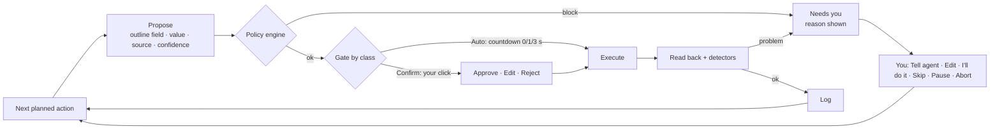

# Phase 1 Plan: Greenhouse Apply Copilot

Status: **plan, not started**. Date: 2026-10-19. Background research: `AUTO_APPLY_RESEARCH.md`.
Decision: **Greenhouse first** (Phase 1a); Workday reuses everything in Phase 1b.

---

## 1. Goal

Apply to Greenhouse-hosted jobs that Job Ops scored and tailored:
- using the **tailored resume PDF from Job Ops**
- filling experience, education and screening questions from your own data
- with **every browser action shown to you before it runs**
- with **Submit always clicked by you**

Success after 20 real applications:

| Metric | Target |
|---|---|
| Wrong answers to protected questions (sponsorship, work authorisation, CTC, notice) | **0** |
| Fields filled without you editing them | ≥ 85% |
| Median time per application, including your review | ≤ 3 min |
| Actions missing from the supervision log | 0 |
| Model cost per application | ≤ $0.03 |

---

## 2. Scope

**In:**
- **Resolver:** find the Greenhouse posting for jobs discovered on LinkedIn, Naukri, Indeed and other boards (§4).
- **Prep:** liveness, duplicate check, form schema, fill plan.
- **Answer bank, and the experience/education filler** (portal-independent).
- **Chrome/Edge extension:** side panel plus Greenhouse form filling, including forms embedded on company careers pages.
- **Supervision:** propose → policy → approve or countdown → execute → read back → log.
- **Writing results back to Job Ops:** apply link, Applied status, and a note through the existing API.
- **Passive capture:** when you click Apply on a LinkedIn job yourself, the extension saves the company link it opens.

**Out (later phases):**
- Workday (Phase 1b)
- Lever, Ashby, SmartRecruiters
- LinkedIn and Indeed assist mode
- Naukri
- accounts and the credential vault
- server-side browsers and the noVNC console
- auto-submit (never planned)

---

## 3. Architecture

**Rule:** everything that must persist lives **on the server**, and **no third-party site is ever contacted from the server**. Outside lookups go from your browser.

```
┌──────────── your PC ────────────────────────────────────────────┐
│ Chrome / Edge: Apply Copilot extension                          │
│  ┌─ Greenhouse tab ─┐   ┌─ Side panel ───────────────────────┐  │
│  │ content script   │◄─►│ queue · plan · next action ·       │  │
│  │ find · fill ·    │   │ approve/edit/reject/tell · timeline│  │
│  │ outline · read   │   └────────────────────────────────────┘  │
│  └──────────────────┘                                           │
│  background worker:                                             │
│   • policy · gate · detectors (supervision)                     │
│   • lookups: Greenhouse Job Board API, careers pages, Clearbit  │──► public internet
│     (your home IP; woken on a timer while Chrome is open)       │    (never from the server)
└───────────────────────────────┬─────────────────────────────────┘
                                │ HTTPS, signed in as you (Job Ops login)
┌───────────────────────────────▼─────────────────────────────────┐
│ your server                                                     │
│  apply-assistant (own container, compose override file)         │
│   • persistent store: apply.db on the server data volume        │
│     answer bank · question map · plans · runs/actions ·         │
│     resolver cache · captured links                             │
│   • planner + AI calls (keys stay on the server)                │
│   • proxies the tailored PDF, writes status/notes to Job Ops    │
│        │ internal network, existing Job Ops API                 │
│  Job Ops (unchanged upstream code)                              │
└─────────────────────────────────────────────────────────────────┘
```

**Who does what:**

| | Extension (your PC) | apply-assistant (server) |
|---|---|---|
| UI, filling, supervision | ✅ | — |
| Greenhouse / careers-page / Clearbit lookups | ✅ (your IP) | ❌ never |
| Persistent data | only a short-lived cache | ✅ all of it |
| AI calls | ❌ | ✅ |
| Talks to Job Ops | via apply-assistant | ✅ internal API calls |

**Background prep:**
- Prep runs while Chrome is open. A `chrome.alarms` timer wakes the extension every ~15 min. The extension asks the server which Ready jobs need lookups, fetches from Greenhouse, and posts the results back. The server then builds plans.
- With the PC off, nothing third-party happens; the queue simply catches up the next time Chrome runs.

**Portability (fork-safe):**
- **Location:** new top-level `apply-assistant/` folder (`server/`, `extension/`, `tests/contract/`). It isn't a root workspace, and has its own `package.json`, lockfile and Dockerfile.
- **Deployment:** `docker-compose.apply.yml` adds the container. The fork's deploy workflow adds `-f docker-compose.apply.yml`; upstream's compose file is untouched.
- **Upstream files edited:** none.
- **Upstream code reused read-only:** `career-boards/greenhouse` (bundled into the extension's lookup code), covered by contract tests after every `git merge origin/main`.
- **Data on the shared volume:** `/app/data/apply.db` sits beside `jobs.db`, so Job Ops' backups can include it.

### 3.1 Deployment on your server (checked 2026-10-19)

**Current setup:**
- Job Ops runs at `https://job-ops.hueint.com`: nginx (managed by **CloudPanel**) → `127.0.0.1:3005` → `job-ops` container (`./data:/app/data`).
- Deploys come from the fork's own workflow, `deploy-credit-savings-remote-focus.yml`: a self-hosted runner does `docker compose build && docker compose up -d --remove-orphans`, with `checkout clean: false`, so `./data` persists.

**How apply-assistant fits:**

| Piece | Choice | Why |
|---|---|---|
| Container | Separate compose **project** `apply-assistant` (`apply-assistant/docker-compose.yml`, started with `docker compose -p apply-assistant …`) | The Job Ops deploy runs `--remove-orphans`. A container in the *same* project but not in upstream's compose file would be deleted on every Job Ops deploy. A separate project is never touched |
| Port | `127.0.0.1:3006` (free) | Localhost only; reached through nginx |
| Data | `./data/apply-assistant/apply.db` (host), mounted into the container | Lives beside `jobs.db` in the persisted `./data` folder; survives deploys (`clean: false`) and any folder-level backup |
| Talks to Job Ops | Joins the `job-ops` compose network as an external network; calls `http://job-ops:3001/api/...` | Internal only, never via the public domain |
| Public URL | `https://apply.hueint.com` (live since 2026-10-20) | Own subdomain: Job Ops' vhost is never touched, the app (and its M2 web page) sits at `/` with no base-path handling, and its browser storage is isolated from Job Ops |
| nginx / DNS | Cloudflare `A apply → VPS` (DNS only) + CloudPanel **Reverse Proxy site** → `http://127.0.0.1:3006`, Let's Encrypt certificate | CloudPanel owns the vhost; no hand edits. The global `client_max_body_size 64M` covers lookup uploads |
| Deploy | New fork-owned workflow `deploy-apply-assistant.yml` (paths `apply-assistant/**`), same self-hosted runner | Independent of the Job Ops deploy; upstream files untouched |
| Auth | apply-assistant validates your **Job Ops login** (login is proxied to Job Ops `/api/auth/login`; the token is checked against Job Ops on each session) | One account; no new passwords |

## 4. Finding the Greenhouse version of a job (resolver)

Your 70+ jobs: only **2** link to Greenhouse directly, but the lookup found **5 more** on their companies' Greenhouse boards, all with the same job open. The resolver does this automatically for every Ready job.

### 4.1 What's reused

Upstream Job Ops already ships `career-boards/greenhouse` (used by the Watchlist). It provides:
- `parseGreenhouseUrl`, `isGreenhouseUrl`: recognise Greenhouse links (`job-boards.greenhouse.io`, `boards.greenhouse.io`, EU boards)
- `extractGreenhouseTokenFromHtml`: find the board token in a careers page (embed scripts, iframes, API calls)
- `guessTokensFromHostname`: `epicgames.com` → `epicgames`
- `resolveGreenhouseSource`: careers URL → validated board token, cheapest method first
- `getJobsFromBoard`, `getJobDetails`: public board listing and job details

The resolver adds only:
1. **company name → domain**
2. **job matching** inside a board
3. a **`?questions=true`** form fetch

### 4.2 Resolution ladder (cheapest first, stop at the first hit)

| # | Step | How | Cost |
|---|---|---|---|
| 1 | Already Greenhouse | Apply link / job URL is Greenhouse, or a `grnh.se` short link (follow the redirect) | free |
| 2 | Cache | `employer → token` (or "none") from earlier runs; refreshed weekly | free |
| 3 | Captured link | The extension saw you click Apply on LinkedIn and recorded the tab URL | free |
| 4 | Domain from job data | `company_url_direct`, email domains, URLs inside the job description | free |
| 5 | Domain from name | Clearbit company autocomplete (name → domain, exact-name match preferred) | 1 request |
| 6 | Careers page | `resolveGreenhouseSource({ url: https://<domain>/careers })`: page scrape, then domain guess, each validated against the board API | 1–3 requests |
| 7 | Name slugs | `zetaglobal`, `zeta-global` from the cleaned company name, validated against the board API | ≤ 2 requests |
| 8 | Rendered careers page | Careers page opened in a background tab of your browser (JS-loaded Greenhouse embeds) | slow, last resort |
| 9 | Manual | **MyGreenhouse Jobs** (`my.greenhouse.io`, Greenhouse's own candidate portal, which searches across all Greenhouse-hosted boards): you search company + title and paste the link | your time |

### 4.3 Matching the right posting on the board

Board found → `getJobsFromBoard` lists every open job (title, location, updated date). Then:

1. **Title filter:**
   - Normalise both titles: lowercase; `Sr.`→`Senior`, `SDE`→`Software Development Engineer`, `BE`→`Backend`; strip levels like "II/III" into a separate field.
   - Keep candidates with token overlap ≥ 0.6.
2. **Location filter:** same city or country, or remote-compatible (India / APAC / anywhere).
3. **Description check:**
   - `getJobDetails` for each candidate; compare its content with the job description stored in Job Ops (`jobDescription`).
   - Use word-shingle Jaccard similarity (no LLM needed).
   - ≥ 0.55: match. 0.30–0.55: "possible match" for you to confirm in the queue. Below 0.30: not a match.
   - Several matches (same role in several cities): take the location match.
4. **Write back** through the existing API:
   - `PATCH /api/jobs/:id { applicationLink: <greenhouse absolute_url> }`. The original LinkedIn URL stays in `jobUrl`.
   - `POST /api/jobs/:id/notes`: "Matched on Greenhouse: board X, job Y, title 0.82, description 0.71".
5. **Optional, company level:** add the board to Job Ops' **Watchlist** (`GET`, then merge, then `PUT /api/watchlist/sources`). Future jobs from that company then arrive with Greenhouse links natively, with no resolving needed. Off by default; you switch it on per company.

**Freshness:** liveness is the same call. If `GET /v1/boards/<token>/jobs/<id>` returns 404, the posting is closed, and the job is marked expired with a note.

### 4.4 Network etiquette

- Only Greenhouse's **official public Job Board API** (built for public use), company careers pages, and Clearbit. Requests go out one at a time with ~300 ms gaps.
- Board listings are cached for 6 h, and token lookups for 7 days. The cache is stored on the server and shared across runs.
- **No LinkedIn page fetching.** LinkedIn links come only from the extension's passive capture.
- All lookups run **in your browser (your PC's IP)**. The server only stores the results.
- Step 8 (rendered careers page) opens the careers page in a background tab of your browser and reads its links. No headless browser is involved.

---

## 5. Pipeline 1: Job Apply

```mermaid
flowchart LR
  subgraph PREP["Prep: extension lookups (your IP) + server planning, on a timer while Chrome is open"]
    P1[Ready jobs<br/>GET /api/jobs?status=ready] --> P2[Resolver §4]
    P2 -->|no Greenhouse posting| PX[Not Phase 1]
    P2 --> P3[Liveness + duplicate check]
    P3 --> P4[Form schema<br/>?questions=true]
    P4 --> P5[Classify fields]
    P5 --> P6[Fill plan §7]
    P6 --> P7[(Queue: plan ready<br/>N auto · M need you · ~min)]
  end
  subgraph RUN["Run: your browser, extension"]
    R1[Open & apply<br/>tab bound to job] --> R2[Find form<br/>page or GH iframe]
    R2 --> R3[Supervised fill §6]
    R3 --> R4[Attach tailored PDF<br/>GET /api/jobs/:id/pdf]
    R4 --> R5[Pre-submit review]
    R5 --> R6[You click Submit]
    R6 --> R7[Confirmation detected]
    R7 --> R8[PATCH status applied<br/>POST note]
    R8 --> R9[Learn: bank + question map]
  end
  P7 --> R1
```



**Field classes from the schema:**

| Class | Examples | Source |
|---|---|---|
| Identity | first/last/preferred name | **answer bank** (`identity.first_name`, `identity.last_name`, `identity.preferred_name`); profile only if the bank entry is empty |
| Contact | email, phone, LinkedIn | profile |
| Links | LinkedIn, GitHub, website, portfolio | profile `basics.profiles` |
| Location | city / "where do you reside" / state / country | **answer bank only** (`location.current_city`, `location.state`, `location.current_country`). Never inferred from the resume or past jobs |
| Files | resume (required), cover letter (optional) | **tailored PDF**; cover letter only when required (Sonnet draft, Confirm class) |
| Education | school, degree, discipline, start/end | experience/education module §8 |
| Employment | company, title, dates (when present) | §8 |
| Custom questions | sponsorship, work authorisation, CTC, notice, years of X, relocation, office days, "how did you hear" | answer bank → question map → Haiku mapping → Sonnet only for open-ended → else **needs you** |
| Demographic / EEO | gender, race, veteran, disability | bank defaults ("Prefer not to say"), Confirm class |
| Consent | privacy / data-retention checkbox | Confirm class, always your click |

**Tailored resume handling:**
- apply-assistant (server) proxies `GET /api/jobs/:id/pdf` to the extension.
- The file is renamed `Firstname_Lastname_Resume.pdf`.
- It's attached to Greenhouse's resume input with a `DataTransfer` file assignment.
- If Greenhouse then fills fields from the PDF, the read-back step compares them with the plan.

**Confirmation detection:**
- Greenhouse's "Thank you for applying" page or a URL change.
- Fallback: the Tracking Inbox later sees the confirmation email.

---

## 6. Pipeline 2: Supervision



**Action classes:**

| Class | Gate | Examples |
|---|---|---|
| **Auto** | Countdown (3 s default; 0 s means approve every action) | identity, links, resume upload, education/experience from your resume |
| **Confirm** | Your click, always | LLM-mapped answers below 0.9 confidence, every drafted text, EEO, consent, "Add another" |
| **Protected** | Bank value only; missing means the run stops | sponsorship, work authorisation, CTC, notice period, date of birth |
| **Never** | Blocked | clicking Submit, leaving the job's site, any other file, downloads |

**Policy engine** (background worker, plain code):
- domain allowlist: `*.greenhouse.io` plus the company domain hosting the embed
- allowed sources per field class
- upload limited to this job's PDF
- no navigation
- daily cap of 15

**Detectors:**
- value didn't stick (one retry with trusted input, then needs you)
- validation error appeared
- required field still empty
- unexpected navigation or modal
- CAPTCHA visible (you solve it on the page)
- email-code field (you type it, never stored)
- field not found

**Your controls:**
- Approve
- Approve remaining Auto (still shown one by one)
- Edit
- Reject
- Tell agent: re-plans that field via Haiku
- **I'll do it**: you fill the field, the value is read back and offered to the bank
- Pause / Resume
- Abort: the job goes to the manual list with its plan

**What you see:**
- **On the page:** an outlined field with a badge such as "5/13 · bank".
- **In the side panel:** the next action and countdown, plus a timeline of agent/you actions with values (secrets masked) and results.
- **In the apply-assistant UI** (served from your server): the full run log per job; a summary goes to Job Ops as a note.

---

## 7. Fill planner

Order for each field (stop at the first confident source):

1. **Answer bank, identity and location keys** for names and where you live. The resume deliberately carries no city, and the name has an initial instead of a surname. These keys take priority over the profile.
2. **Profile / resume** (`GET /api/profile` + design-resume JSON) for email, phone, links, experience, education: deterministic.
3. **Experience/education module** (§8): deterministic.
4. **Answer bank** by exact key.
5. **Question map:** normalised question text → bank key, learned from earlier forms or your confirmations.
6. **Haiku 5.5 mapping:** structured output `{key, confidence}` chosen from bank keys and the field's own options. Protected keys take the bank value, never the model's.
7. **Sonnet 5.5 draft:** only for open-ended text, using the JD plus the job's `tailoredSummary` / `tailoredHeadline` / `tailoredSkills`. Always Confirm class.
8. **Needs you:** never guess. There's no fallback from other data either (e.g. a past job's location is never used as your city).

Select and multi-select fields are matched against the form's own options with **fuse.js** before any model call.

---

## 8. Experience & education module (portal-independent)

The source is your Job Ops design resume:
- **experience:** 4 items with `company`, `position`, `location`, `period`, `description`
- **education:** 2 items with `school`, `degree`, `area`, `grade`, `location`, `period`

| Step | Rule |
|---|---|
| Dates | Parse `Mon YYYY - Mon YYYY \| Present` to `{startMonth, startYear, endMonth, endYear, current}` with date-fns |
| Degree | Synonym table to a canonical level (B.Tech/BE/B.Sc → Bachelor's; M.Tech/MS/MCA → Master's), then fuse.js against the form's options. Haiku fallback is Confirm class |
| School / company typeahead | Type the name and pick the closest suggestion (fuse.js); otherwise "Other" plus the typed name. Confirm class |
| Repeaters | One proposed "Add another" per extra entry, most recent first, up to the form's limit |
| Descriptions | The resume's own text, trimmed to the field limit. No rewriting |
| Consistency | The same source produces the tailored PDF, so typed fields always match the uploaded file. Job Ops tailoring changes summary/headline/skills/projects, not experience or education |
| Read-back | Every block is re-read after filling, because dates and dropdowns are where portals silently change values |

The same module serves Workday in Phase 1b, where it also corrects Workday's resume-parse autofill.

---

## 9. Data model (server: `/app/data/apply.db`, apply-assistant container)

| Table | Key columns |
|---|---|
| `employer_domains` | employer_norm, domain, method, confidence, checked_at |
| `gh_boards` | employer_norm, token (nullable = none), method, checked_at, jobs_cache_json, jobs_cached_at |
| `apply_targets` | job_id, gh_token, gh_job_id, gh_url, match_method, title_score, desc_score, status (matched/possible/none/closed), updated_at |
| `fill_plans` | job_id, schema_hash, plan_json, auto_count, needs_you_count, est_minutes, built_at |
| `answer_bank` | key, value, protected, notes, updated_at, updated_by |
| `question_map` | question_norm, key, confidence, confirmed_by_you, uses |
| `runs` | id, job_id, started_at, ended_at, outcome, interventions, model_cost |
| `run_actions` | run_id, seq, class, field_ref, value_masked, source, confidence, decision, decided_by, result, ts |
| `captured_links` | job_id, source_url, captured_url, decoded_url, captured_at |

## 10. apply-assistant API on the server (used by the extension; same login as Job Ops)

| Method | Path | Purpose |
|---|---|---|
| GET | `/queue` | Greenhouse-ready jobs with plan summary |
| GET | `/plans/:jobId` | fill plan |
| POST | `/plans/:jobId/rebuild` | rebuild after bank edits |
| GET | `/jobs/:jobId/resume.pdf` | proxied tailored PDF |
| POST | `/runs` · `/runs/:id/actions` · `/runs/:id/complete` | run log; complete → PATCH applied + note in Job Ops |
| POST | `/runs/:id/tell` | re-plan one field from your instruction |
| GET / PUT | `/answer-bank` | bank editor |
| POST | `/question-map/confirm` | save a question→key mapping you approved |
| POST | `/captured-links` | passive LinkedIn Apply capture → resolver |
| GET | `/lookups/pending` | jobs that need Greenhouse/careers lookups (the extension performs them) |
| POST | `/lookups/results` | extension posts lookup results (board token, job list, schema, liveness) |
| POST | `/resolve/:jobId` | manual "find on Greenhouse" / paste a MyGreenhouse link |

---

## 11. Reuse summary

| Need | Use | Licence |
|---|---|---|
| Greenhouse URL, token, board, job details | **upstream `career-boards/greenhouse`** (read-only import) | repo licence |
| Extension framework | **WXT** | MIT |
| Trusted input (required, per M0) | **nanobrowser** browser-control layer (`chrome.debugger`), copied into `extension/vendor/` with NOTICE | Apache-2.0 |
| Option matching | **fuse.js** | Apache-2.0 |
| Dates | **date-fns** | MIT |
| LLM | **@anthropic-ai/sdk**: `claude-haiku-5-5` mapping, `claude-sonnet-5-5` drafts | MIT |
| Server + DB (on your server) | **Express + better-sqlite3 + drizzle** (same stack as Job Ops) | MIT |
| Company domain | Clearbit autocomplete (free, no key) | service |
| Manual cross-board search | **MyGreenhouse Jobs** (`my.greenhouse.io`) | service |

---

## 12. Milestones

| # | Milestone | Tasks | Done when | Est. |
|---|---|---|---|---|
| **M0** | Spike (dry run, never submits) | WXT skeleton. On 5 live Greenhouse forms (1 embedded iframe, 1 with education): fill text, react-select, location typeahead, education repeater, `DataTransfer` resume upload; read everything back. Decide whether the nanobrowser input layer is needed | All field types fill and read back on all 5 | 2–3 d |
| **M1** | Server store + resolver | apply-assistant container (compose override), store + API, Job Ops client (login, jobs, profile, PDF, PATCH, notes), **contract tests**. Resolver ladder §4.2 split: lookups in the extension background, cache/matching/write-back on the server. Liveness | ≥ 90% of known Greenhouse jobs resolve correctly; the 5 found today resolve automatically | 4–5 d |
| **M2** (core done 2026-10-20) | Prep + planner + answer bank | `?questions=true` fetch, field classifier, experience/education module, answer bank UI (protected keys), question map, Haiku mapping, Sonnet drafts, queue page | Every resolved job shows a plan with "needs you" counts | 3–4 d |
| **M3** (M3a+M3b done 2026-10-20) | Extension: supervised fill | Side panel (queue, plan, next action, timeline, controls), content script for page + iframe, fillers, policy engine, gate and classes, detectors, "I'll do it" capture, submit detection, mark-applied, passive LinkedIn capture | One real application end to end, every action logged | 6–8 d |
| **M4** | Dogfood | 20 real supervised applications; fix what breaks; tune thresholds | §1 targets met | ~1 wk (in parallel with use) |

**Total: about 3 weeks of build plus a week of real use.**

---

## 12B. M2 status (2026-10-20)

Done and deployed at `https://apply.hueint.com`:
- **Form schema:** `fetch-schema` lookup task for matched postings (re-fetched after 3 days); the server parses `?questions=true`, stores it (`form_schemas`, migration 2) and builds the plan.
- **Planner:** classifier (Greenhouse names + question-text rules), resume facts from the design resume, experience/education (dates, degree level), option matching (exact > prefix > word > contains, fuse.js for near misses), work authorisation from `work.authorized_countries` + the job's country, EEO decline, consent. Missing answers become "needs you" with the reason; nothing is guessed.
- **Answer bank:** 23 catalogue keys with groups, hints, protected flags; saving rebuilds every plan.
- **Web page** (`/`): sign in with Job Ops, answer bank editor, queue with Greenhouse status and plan counts, plan per job with "Answer it" links.
- **Lookups** also cover Discovered jobs scoring 70+ (only 1 of 87 such jobs was Ready).

Verified on real data (read-only run, `spike/e2e-real.ts`): 24 lookups → 3 matched (title 1.00, descriptions 0.97–1.00) → 3 plans; each needs only answer-bank items (name, country, city).

**Claude step (2026-10-20, deployed):** required questions the rules don't recognise go to Haiku 5.5 in one structured-output call per form. Haiku either points to a saved answer (`bank`), answers factually from the resume (`answer`), or asks for a written answer (`write`), which Sonnet 5.5 drafts. Replies are checked: choices must match the form, bank keys must be real, and there are length limits. Replies are cached by input hash (`claude_answers`, migration 3). Every Claude answer is `confirm` (`protected` when it points to a protected key), and below 50% confidence it is only a suggestion. Identity, EEO and protected values are never sent. The key lives in `data/apply-assistant.env` on the server (optional `env_file`). Without it, the questions stay "needs you". Smoke test on fixtures (`spike/claude-questions.ts`): Haiku declined to claim skills missing from the resume, and mapping plus drafting cost about $0.001. Not done yet: remembering mappings you confirm (`question_map`).

**M3a/M3b (2026-10-20):** extension in `apply-assistant/extension` (WXT, puppeteer-core `ExtensionTransport` for trusted input). Lookups run from the browser every 30 min. Supervised fill runs in the side panel and logs each step on the server; Submit is always yours. A dry run on a real Greenhouse form passes 9/9 steps. Findings: Location is `input_text` in the API but an async react-select on the page; search text must be inserted in one event; the phone Country select shows only the dial code.

## 12C. Beyond Greenhouse (2026-10-20, deployed)

**LinkedIn apply-link capture (M3c).** When you click Apply on a LinkedIn job, the extension follows the tab that opens. It uses `webNavigation`, so it sees addresses only and never reads LinkedIn's pages. It decodes `externalApply` and job-ad redirectors, and the server saves the company link to the job in Job Ops (`applicationLink` plus a note). The job's old lookup is then forgotten, so the next lookup starts from the real application page. `e2e/capture.e2e.mjs` runs in a real Chrome with every hostname resolved to a local stub.

**Several application systems.** Every target, board-cache entry and stored form names its system (`ats`, migration 4). A cached "no board" answer records which systems were searched, so adding a system rechecks those companies (migration 5). Each system has a board module in the extension (exists, list, describe, verify, form), a server parser, and a driver on the shared `TrustedDriver` base.

| System | Listings / liveness | Form definition | Driver notes | Verified on a real form (dry run) |
|---|---|---|---|---|
| Greenhouse | Job Board API | `?questions=true` | react-select via keyboard | Platform Science, 9/9 |
| Ashby | posting API (descriptions included) | read-only `ApiJobPosting` query | `data-field-path` containers; radios; location search; a Location field can be country-only (`locationTypes`) | ElevenLabs: everything filled except the 2 needs-you |
| Lever | postings API | the apply page's `<form>`, parsed on the server (card JSON plus labelled standard fields) | fields by `name`; resume attached **first** (Lever fills fields from it) | Valiantys, stub mode with fake details: 14 steps |
| SmartRecruiters | public API works | — | **Not supported.** Application pages are behind DataDome bot protection (403 to automated browsers); not worked around | — |

Live result: ElevenLabs (a Ready job) is matched on Ashby and planned. Its 2 needs-you are "How did you hear" (empty in the answer bank) and GitHub (not on the resume).

## 12G. Phase 1b: Workday (started 2026-10-21)

**Why it starts differently.** Workday's application forms only appear after you sign in to each company's Workday account, so they can't be fetched ahead of time the way Greenhouse, Ashby and Lever forms are, and I can't open them myself.

**Plan:**
1. **W0: record manual applications (done 2026-10-21).** On a tab belonging to a queued job (never LinkedIn; sites the extension may read), each new form page records:
   - its fields: label, name and id, `data-automation-id`, choices, required, your answers;
   - a page snapshot;
   - a screenshot when the tab is in front (needs the all-sites permission, now `<all_urls>`);
   - each changed answer;
   - every Next / Continue / Submit click, with the whole page.

   Password and one-time-code values are never read. Code: `src/track/inspect.ts`, `manual-capture.ts`. Checked in `e2e/kit.e2e.mjs`.
2. **W1: one recorded application (done 2026-10-21, LPL Financial).**
   - The recording captured 4 form pages, 39 answers, 7 step clicks and 11 snapshots. There were no screenshots because the all-sites permission hadn't been re-granted.
   - Its six steps are Autofill with Resume, My Information, My Experience, Application Questions, Voluntary Disclosures and Review.
   - The snapshots, with personal values replaced by fakes, are the test fixtures in `extension/test/fixtures/workday/`.
3. **W2: Workday filler (built 2026-10-21; first live test is your next Workday application).**
   - **Page by page.** You sign in and open the application. "Fill this page" in the side panel then:
     - reads the page's fields;
     - opens each dropdown to list its choices, then closes it again;
     - has the server plan that page (`POST /plans/:jobId/page`);
     - fills it step by step as usual.
   - **Your part.** You check each page and click Save and Continue. The next page is read and filled when it opens. On Review, you submit.
   - **Fields** come from the recorded pages, not other projects' ids:
     - each field's container is `data-automation-id="formField-<key>"`;
     - its `data-fkit-id` is the control's id, used as the plan's ref;
     - required fields carry an `<abbr>*</abbr>`.
   - **Field kinds:**
     - dropdowns are buttons that open a listbox;
     - "search" fields (How did you hear, Country Phone Code) take text plus Enter and keep picks as tags;
     - radios, checkboxes and text;
     - the resume upload sits outside the field containers.
   - **What fills what** (`server/src/plan/workday-schema.ts`):
     - names, country, phone, the phone's country code and "worked here before" come from your answer bank;
     - Phone Device Type is always Mobile;
     - "How did you hear" and the application questions go through the usual rules, then remembered answers, then Claude;
     - work history, education, skills and dates are left to Workday, which fills them from your resume;
     - the resume is attached on Autofill with Resume, so it goes first.
   - **Tests:**
     - the page reader runs on the recorded pages;
     - the page planner runs on the LPL field sets;
     - `e2e/workday.e2e.mjs` runs a supervised fill on a fake Workday wizard through the built extension.
   - Workday's domains are now in the extension's own site list, so its pages are recognised without the all-sites permission.
4. **W3:** Workday lookups (posting liveness) from the public job-board API.

Your Job Ops has 10 Workday jobs: FactSet and Hitachi (applied); Capital One, LPL, Visa, Genpact, ModMed, Candescent and insightsoftware (Discovered). FactSet's manual application predates W0, so only its kit actions were recorded.

## 12F. Phase 1 status (2026-10-21)

Everything planned for Phase 1 is built and live:
- M0–M3c;
- Greenhouse, Ashby and Lever;
- the Claude step, Tell agent and remembered answers;
- run trace, apply kit and tracked tabs (T1–T3).

What's left is **M4**: your real supervised applications until the §1 targets hold on the Progress tab (5 of 20 so far).

**Workday (Phase 1b)** was resumed at your request on 2026-10-21; see §12G.

## 12E. M4: dogfooding (started 2026-10-21)

M4 is about 20 real supervised applications measured against the §1 targets. Built for it:
- **Progress tab** (`GET /progress`): computes all §1 targets from submitted supervised runs, their run log and their trails.
  - "Filled without you changing them" counts an edit that keeps the planned value as an approval; the side panel now records the planned value with every decision.
  - Kit (manual) applications are counted separately.
- **Claude cost per job:** every Claude call is traced as `claude-usage` with tokens and dollars (`claude/pricing.ts`: Haiku 5.5 $0.10/$0.50, Sonnet 5.5 $2/$10 per MTok).
- **Remembered answers** (the `question_map` idea, migration 7 `learned_answers`):
  - **Saved:** an answer you edit in the side panel, or type on the page with "I'll do it", keyed by the question with the company name removed.
  - **Reused:** before asking Claude, on any form asking the same question, as long as it fits that form's choices. Shown with the date you gave it, and still needs your click.
  - **Not learned:** answer-bank, resume, protected and voluntary answers; those are corrected at their source.
  - **Managing them:** they're listed under Answer bank, and "Forget" removes one.
- **Fewer Claude calls:** "Are you located in X?" goes to Claude only when your saved location can't settle it.

## 12D. Run trace and apply kit

Planned in its own file: [APPLY_TRACE_AND_KIT_PLAN.md](APPLY_TRACE_AND_KIT_PLAN.md). It covers:
- a per-job record of what the server, the extension and the page did, with snapshots, to debug from data;
- an apply kit for sites without a filler: one-click copy or fill, the resume saved to a known path, and Ask Claude;
- tracked application tabs;
- learning from manual applications.

## 12A. M0 spike results (2026-10-19, dry run, fake data, nothing submitted)

Forms tested:
- **New Relic:** standard Greenhouse job page, with an Education section.
- **Fivetran:** Greenhouse embedded in an iframe on the company's own careers page.

The spike scripts are in `apply-assistant/spike/`. Every non-GET request was blocked, so nothing was posted or uploaded, and Submit was never clicked.

| Field type | Result with trusted input (CDP = what `chrome.debugger` gives the extension) |
|---|---|
| Text (name, email, address, city…) | ✅ 11/11 (phone is reformatted by its widget, e.g. `98765 43210`, so compare digits) |
| Searchable dropdowns (country, yes/no screening, "how did you hear", EEO) | ✅ 13/13 |
| Location autocomplete | ✅ `Bengaluru, Karnataka, India` |
| Education: school / degree / discipline | ✅ degree + discipline; school ✅ via "Other" (a school-name search returned no match, so test more names in M3) |
| Education "Add another" | ✅ |
| Checkbox group (pronouns) | ✅ |
| Resume file input | ✅ file attached (the upload itself was blocked by the spike, see below) |
| Embedded form behind a tab | ✅ after a "reveal" click on the page's **Application** tab |

**Findings that change the design:**
1. **All input must be trusted (chrome.debugger).**
   - Synthetic events (setting the value and dispatching events from the page) don't open dropdowns.
   - Text set that way is **wiped** when the form re-renders after a real interaction.
   - So the extension drives every field through `chrome.debugger`. The content script only locates fields, outlines them and reads them back.
   - The vendored nanobrowser input layer moves from "maybe" to **required**.
   - Chrome shows a "started debugging this browser" bar while it's attached; that's acceptable under supervision.
2. **Education is flagged, not listed (corrected 2026-10-20).** `?questions=true` doesn't list School/Degree/Discipline (`school--0`, `degree--0`, `discipline--0`), but its top-level `education` field says whether the section exists (`education_required` / `education_optional`, absent = none). The planner adds the three fields from that flag; no DOM scan needed.
3. **Attaching the resume uploads it immediately** to Greenhouse's storage (an S3 POST), **before Submit**. So the resume is attached as the **last step, after your "ready to apply" approval**, never during exploration or an abandoned run.
4. **Field order matters:** country before phone (the phone widget follows the country), country before state.
5. **Embedded forms can be hidden:** they can sit in a closed tab, behind "Apply now", or under cookie banners and pop-ups. A "reveal form" step is proposed first (Confirm class). The extension never clicks cookie-consent buttons; you do.
6. **Option matching needs ranking:** exact, then starts-with, then whole word, then contains (`India` must not pick "British Indian Ocean Territory"). Only visible dropdown options count, because the phone widget's hidden country list also uses `role="option"`.
7. **Field IDs are stable and match the API** (`first_name`, `email`, `country`, `candidate-location`, `question_<id>`, `school--N`), so plan→DOM mapping is direct, in the job-board page and the embed alike.

**Dry run with real Job Ops data (same day):**
- **Inputs:** the 7 highest-scoring open jobs that link to Greenhouse or whose company has a Greenhouse board, your Job Ops profile, and a real tailored PDF.
- **Resolver:** found all 7 postings. 4 by title match on the company board (0.75–1.00), 1 via a `grnh.se` redirect, 2 direct. 1 posting (New Relic) is closed.
- **Fill:** **49/49 planned fields filled** (country, name, email, phone, location, LinkedIn; resume attach triggered and its upload blocked). **50 required questions had no source**, so they're answer-bank work for M2: sponsorship, right to work, salary acknowledgements, "how did you hear", years of experience, address…
- **Profile gaps found:** no separate last name, and no city. **Decision:** both live in the answer bank (`identity.last_name` = your initial, `location.current_city`). The resume stays unchanged, and the experience-location fallback used by the spike is removed from the planner.
- **Not exercised:** none of these 7 forms had an Education section, so education with real resume data is still untested. Education itself works (New Relic, fake data).

Still to prove in M3, with you applying for real:
- the actual resume upload succeeding
- confirmation-page detection
- invisible reCAPTCHA behaviour
- school-name search with real school names

## 13. Risks & mitigations

| Risk | Mitigation |
|---|---|
| react-select / typeahead widgets ignore synthetic input | M0 decides; fallback is trusted input (nanobrowser layer) or "I'll do it" |
| Invisible reCAPTCHA blocks submit | You're in your own browser at home with a real session, and you click Submit. If it challenges, you solve it |
| Resolver picks the wrong posting | Description-similarity check; "possible match" needs your confirmation; the original link is kept |
| Few Greenhouse jobs at any moment | Watchlist feed (opt-in per company) brings Greenhouse jobs in natively; Workday follows in Phase 1b |
| Upstream changes the API or `career-boards/greenhouse` | Contract tests after every merge; apply-assistant pins what it uses |
| Sensitive data | Bank and logs live in `apply.db` on your server (same volume and backups as Job Ops). Codes are never stored, secrets are masked in logs, model keys stay server-side. The extension only holds a short-lived session token |

## 14. Decisions

Decided on 2026-10-19:
- Persistent data lives **on the server** (apply-assistant container); third-party lookups run **from your browser**.
- No local program on your PC, only the extension.
- Browser: **Chrome** first; the same build works in Edge.
- Auto actions: **3 s countdown** by default, switchable to 0 s (approve every action) per portal or globally.
- Watchlist feed: **ask per company** after a match.
